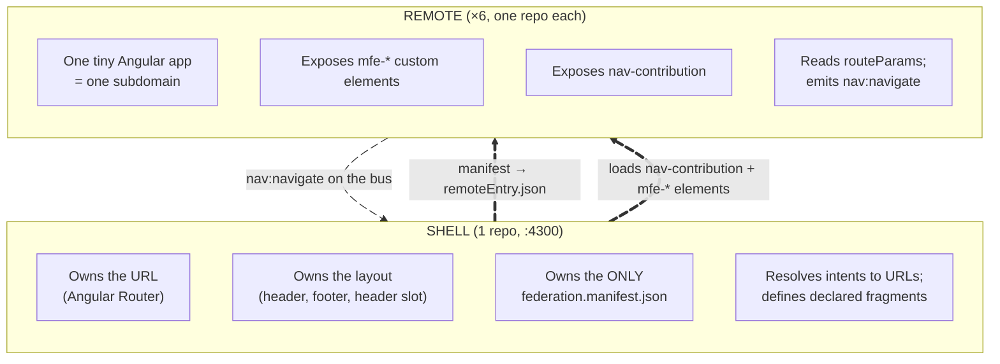
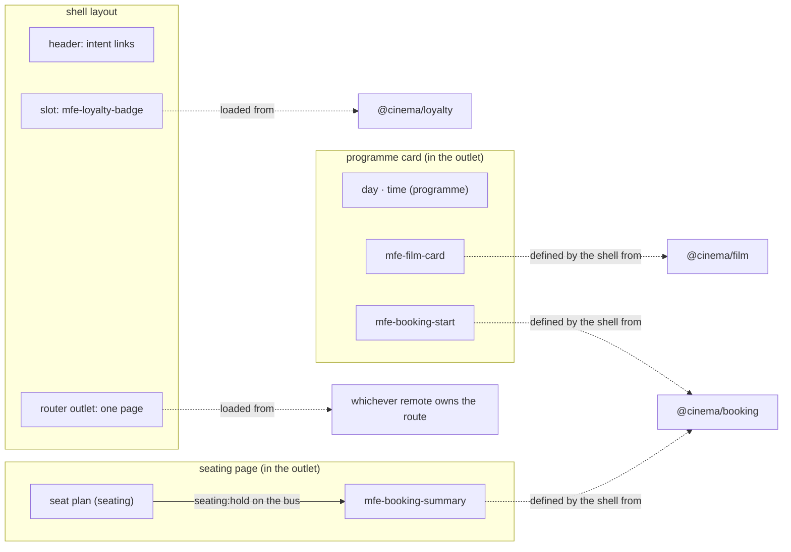

# Architecture

This document covers how seven independent repos become one page at
runtime. The mechanics are the tractor store's (see
[`../../tractor-store/docs/architecture.md`](../../tractor-store/docs/architecture.md)
and [`navigation.md`](../../tractor-store/docs/navigation.md)). This document
covers only what this demo keeps, what it drops, and what changes when there
is no monorepo.

## Shell and remotes



The one domain event, `booking:confirmed`, goes remote → remote (booking →
loyalty) over the same bus. The shell does not subscribe to it.

### The shell

The shell is an application, not a subdomain. It holds **no domain data**,
and its code (`src/app`, `src/shared`) **never subscribes to or emits a
domain event**. Its `contracts.ts` only holds the reference types that every
repo copies (ADR-03).

- `main.ts`:
  - fetches `public/federation.manifest.json` with `no-cache`;
  - runs the orchestrator's `initFederation(manifest, { ...useShimImportMap({ shimMode: true }), hostRemoteEntry: './remoteEntry.json', ... })`.
    `hostRemoteEntry` puts the shell's own shared Angular in the import
    map, so its versions win (ADR-08);
  - on failure logs a fixed `console.error`. There is no `env.config.json`
    and no `showErrors` switch.
- `navigation.ts`, adapted from the tractor-store host:
  - builds one route per intent of the loaded contributions, mounted by one `RemoteShellComponent` that
    sets the tag and writes `routeParams`;
  - always adds a `**` catch-all: a **redirect** to the first parameterless
    page that loaded, in manifest order (programme comes first). If none loaded, `**` is an empty route
    (`children: []`) that keeps the URL and renders nothing in the outlet, so
    the router never throws `NG04002`. There is no "not available" page;
  - emits the intent table on `nav:intents` (full id → absolute path with
    `{name}` placeholders, e.g. `'seating.plan'` → `'/seating/{screeningId}'`)
    and handles `nav:navigate` (see [Events](#events)). The shell and every
    `[navIntent]` copy fill in a URL with the same `urlFor()` from
    `src/shared/navigate.ts`, so an `href` and a navigation never differ;
  - one addition to the tractor-store host: a `nav:navigate` that cannot be
    filled in **`console.warn`s when the intent's team did load** (an
    unknown id or a missing param). Without that, a misspelled id looks
    exactly like a remote that is down. An intent of a team that did not
    load is ignored silently (ADR-12). A link with a drifted id or param
    renders inert, like a link to an absent team.
- `contributions.ts` loads the `nav-contribution` of every present remote
  with `Promise.allSettled` before Angular starts. An absent remote (off or
  down) is skipped silently (ADR-12); only a remote that loaded but exposes
  an invalid contribution logs a `[nav]` warning. It derives the main menu
  and the `header` slot from the result (ADR-13), and defines the declared
  fragments (see [Fragments and resilience](#fragments-and-resilience)).
- `remote-fragment.ts` mounts one fragment element; `remote-element.ts`
  holds the remote loader, so the host's separate `load-remote.ts` is not
  copied.
- `RemoteShellComponent` writes **path params only** into `routeParams`, so
  `RouteParams` is `Record<string, string>`.
- The layout: a header whose menu holds one link per intent with a
  `menuLabel` and the `header` fragments, each team's after its own links;
  a footer; the global stylesheet.
  The layout names no remote.
  The shell's `<main>` owns the page container (max-width, padding); a
  remote renders only its content, never its own max-width or gutter.

### A remote

A remote is one Angular application, created once and shared by all of its
elements.

- `src/app.config.ts` exports `getAppInjector()`, which does
  `injector ??= createApplication(...)` (the tractor-store pattern). Every
  exposed element imports this module, so esbuild puts it in one shared
  chunk and the remote has exactly one injector. That is how loyalty's badge
  and page share one `PointsStore`.
- `src/bootstrap.ts` exports `bootstrap(): Promise<void>`. It calls
  `customElements.define(tag, createCustomElement(...))` for each element it
  owns. It takes no `env` and no `nf`: there is no env config, and no remote
  loads another remote, so **no remote imports the orchestrator at
  runtime** except in standalone `main.ts`.
- `federation.config.mjs` exposes one key per tag, and the key **is** the tag
  name. **Every** remote also exposes `nav-contribution`. That keeps the
  shell rule simple: a remote without a contribution is a broken remote,
  skipped with a `[nav]` warning.
- `src/main.ts` runs **only in standalone mode** (the shell loads
  `bootstrap.ts`, never `main.ts`). See
  [Local development](#local-development).
- No remote has a `federation.manifest.json` file. Standalone mode passes an
  inline empty manifest.

## Integration contracts: the complete list

There are six. Anything not on this list is private to one repo.

| # | Contract | Shape | Who agrees |
|---|---|---|---|
| 1 | **Manifest** | `@cinema/<team>` → `remoteEntry.json` URL; the key equals the remote's federation name | Shell and the deployment |
| 2 | **Exposed element** | Exposed key = tag name. Its module is a `RemoteElementModule`: `{ bootstrap(): Promise<void> }`. Fragments are declared in the `nav-contribution`, never hard-coded in the shell. | Shell and each remote |
| 3 | **`nav-contribution`** | `{ basePath, intents: [{ id, path, element, menuLabel? }], fragments?: [{ element, slot? }] }` with a **local** `id` (`'plan'`); the shell builds the full id `basePath.id` (`seating.plan`). `slot` is absent (pages embed it) or `'header'` (the shell also places it). | Shell, every remote, and each caller of an intent |
| 4 | **`routeParams`** | One property the shell writes onto a routed element: **ids, plus the one documented `seats` string**. Param names equal the `{placeholders}` in the owner's path. | Shell, each page and each caller |
| 5 | **Bus channels** | `nav:navigate`, `nav:intents`, `booking:confirmed`, `seating:hold` | Producer and consumers |
| 6 | **Embedded fragment** | Tag plus **one id as an attribute**: `<mfe-film-card film-id>`, `<mfe-booking-start screening-id>`, `<mfe-booking-summary screening-id>`. It emits no domain events and consumes none, except that the summary reads seating's retained `seating:hold` (ADR-16). | The fragment's owner and the host page (programme; seating for the summary) |

Pages take one `routeParams` property, and embedded fragments take named id
attributes. That is two input conventions on purpose: a route passes a bag
of params, and an embed passes one id. Both are **configuration**, set once
by whoever places the element. Everything micro-frontends **communicate**
goes over the bus, also between two elements on the same page
([ADR-16](decisions.md#adr-16-seatings-hold-is-shared-state-the-handoff-stays-in-the-url)).

The runtime contract is **strings**: tag names, exposed keys, intent ids,
param names, event names and the manifest's remote names. TypeScript types
only document those strings. How each contract is verified is in
[testing.md § Contract matrix](testing.md#contract-matrix).

### Naming conventions

No compiler checks names across repos, so every name carries its team's
prefix (Geers: "establish team prefixes").

| Thing | Pattern | Example |
|---|---|---|
| Federation name | `@cinema/<team>` | `@cinema/seating` |
| Tag = exposed key | `mfe-<team>-<thing>` | `mfe-seating-plan` |
| `basePath` = first URL segment | `<team>` | `/seating/...` |
| Intent id | `<team>.<thing>` | `seating.plan` |
| Domain event | `<team>:<past-tense-verb>` | `booking:confirmed` |
| Infrastructure event | `<capability>:<noun or verb>` | `nav:navigate`, `nav:intents` |
| Team state (retained) | `<team>:<noun>` | `seating:hold` |

Avoid names that stutter. `mfe-seating-plan` is fine. `mfe-seating-seat-plan`
is not.

### Intents

The tractor-store rule is kept: the URL is `/{basePath}/{path}`, so **each
team owns its URL prefix**, and no team's URL borrows another team's noun.

| Intent id | `basePath` + `path` | URL | Element | Params |
|---|---|---|---|---|
| `programme.list` | `programme` + `''` | `/programme` | `mfe-programme-list` | none |
| `film.detail` | `film` + `{filmId}` | `/film/{filmId}` | `mfe-film-detail` | `filmId` |
| `seating.plan` | `seating` + `{screeningId}` | `/seating/{screeningId}` | `mfe-seating-plan` | `screeningId` |
| `booking.checkout` | `booking` + `{screeningId}/{seats}` | `/booking/{screeningId}/{seats}` | `mfe-booking-checkout` | `screeningId`, `seats` |
| `loyalty.points` | `loyalty` + `''` | `/loyalty` | `mfe-loyalty-points` | none |
| `account.profile` | `account` + `''` | `/account` | `mfe-account-profile` | none |

`/` and every unknown URL redirect to `/programme` (see
[The shell](#the-shell)).

**The `seats` format** is the only structured value in a route. It is
booking's own since ADR-16: booking's summary writes it (`formatSeats`) and
checkout reads it (`parseSeats`), both in `booking/src/seats-param.ts`.

- seat codes joined by commas, **sorted** by row letter, then by seat
  number (`A1,A2,B10`, never `A2,A1`); seating's `seating:hold` already
  lists them in that order;
- booking never links to an empty hold ("Continue" is a disabled button
  until a seat is held);
- booking treats an empty or unparsable value from a deep link as an empty
  checkout, and does not throw;
- the shell URL-encodes it, but Angular's router leaves `,` unescaped, so
  the address bar shows `/booking/s-101/A1,A2`. A typed `A1%2CA2` deep link
  works too. Booking receives the decoded value through `routeParams`.

The copied `urlFor()` also turns extra payload keys into a query string. The
demo simply does not use that, and the shell does not pass query params on
to `routeParams`.

### Events

The bus is [`@softarc/native-federation-communication`](https://github.com/native-federation/communication). The shell
installs it once, on `globalThis.__NF_BUS__`, with
`import '@softarc/native-federation-communication/install'` as the first
import of `app/bootstrap.ts` (`main.ts` is too early: shared packages resolve
only after `initFederation`). Exposed modules never install it. Every copy
of the package finds that one bus,
whichever Angular major or share scope the repo uses (see
[Shared dependencies and versions](#shared-dependencies-and-versions)).
`bus.emit(channel, value)` retains the value, and `bus.on` hands a retained
value to a new listener before it returns. `{ retain: false }` makes the
value a **command**: only current listeners get it, and nothing is kept.

| Channel | Kind | Direction | Emitted / subscribed with |
|---|---|---|---|
| `nav:navigate` | command | any remote → shell | emitted with `{ retain: false }` (`navigateTo()` in `src/shared/navigate.ts`); the shell listens with `{ replay: false }`: an old navigation must never be replayed |
| `nav:intents` | state: the shell's `NavIntents`, frozen | shell → any `[navIntent]` | `bus.emit('nav:intents', intents)`, retained; `bus.on` without options: a link that renders late still gets the table, and one that renders before it waits for it |
| `booking:confirmed` | domain fact, sent as a command | booking → loyalty | `{ retain: false }` and `{ replay: false }`, see [ADR-05](decisions.md#adr-05-one-domain-event-sent-as-a-command-shell-mounted-consumers-only) |
| `seating:hold` | state: `SeatHold { screeningId, seats }`, seats in grid order | seating → booking's summary | retained, emitted from one `effect()` on every change, including the empty hold on first render and on a new screening; `bus.on` without options, filtered on the summary's `screening-id`, see [ADR-16](decisions.md#adr-16-seatings-hold-is-shared-state-the-handoff-stays-in-the-url) |

To watch the bus, open **Events** next to **Remotes** at the bottom left
of the shell (`shell/src/event-log/`, demo tooling like the remote
switcher; one dock panel is open at a time, Escape closes it). It lists
every emit on every channel, from the shell and every remote, newest first:
one collapsed row each with its kind (state or command), channel, a
one-line preview and the time; a row expands to the pretty-printed value. It uses `bus.tap`, which sees
all channels, so it needs no list of channel names. `tap.replay()` adds the
values retained before it started, such as `nav:intents`. The envelope does
not say which app emitted, so the panel does not either.

### Team colours

Every micro-frontend is lightly accented in its own colour, always: programme
navy, film vermillion, seating green, booking amber, loyalty magenta, account
sky. Only the hue changes; shape, type, spacing and surfaces stay shared, so
it reads as one product. The shell's header is neutral, and each team's
menu link carries a dot in its colour as the legend.

- One block in `shell/src/styles.scss` maps each `mfe-*` tag to a `--team`
  colour and derives the Material roles the remotes already use
  (`--mat-sys-primary`, the containers) from it, so their buttons, chips and
  seats take the team's hue without changing the remotes.
- One quiet cue per piece keeps nested pieces apart: programme's cards get a
  faint outline, film's card a left stripe, booking's summary a top stripe;
  booking's Book button is filled, so it is amber everywhere.
- The palette and the mapping live in the shell only, so the header dots
  and the accents can't drift apart. The cost: the shell knows every tag
  name, and a team does not pick its own colour.

## Fragments and resilience

There are four cross-team fragments. A remote declares each one in its
`nav-contribution`; the shell **defines** every declared fragment, and a
`slot` only says where the shell also **places** it
([ADR-15](decisions.md#adr-15-pages-may-embed-declared-fragments-the-shell-defines-them)).

| Element | Owner | Placed by | Input attribute |
|---|---|---|---|
| `mfe-loyalty-badge` | loyalty | shell `header` slot | none |
| `mfe-film-card` | film | programme's screening card | `film-id` |
| `mfe-booking-start` | booking | programme's screening card | `screening-id` |
| `mfe-booking-summary` | booking | seating's page, beside the plan | `screening-id` (and seating's `seating:hold` on the bus) |



**How embedding works.**

- `contributions.ts` has `declaredFragments(contributions)` (every valid
  fragment, with or without a slot), `fragmentsIn(contributions, 'header')`
  on top of it, and `defineFragments(contributions, load)`, which calls
  `load(remoteName, element)` for each declared fragment. A rejection logs
  the same `[remote] failed to load <…>` error as `remote-fragment.ts`; it
  never throws.
- `bootstrap.ts` creates the loader once, calls `defineFragments` right
  after `loadContributions` **without `await`**, so the first paint does not
  wait, and passes the same loader to `LOAD_REMOTE`.
- The owning remote exposes the tag (`'mfe-film-card': './src/bootstrap.ts'`)
  and its `bootstrap()` defines all its tags, each behind its own
  `customElements.get` guard, so the shell's eager load and a route load can
  race safely.
- The host page writes the tag. Only `ProgrammeListComponent` gets
  `schemas: [CUSTOM_ELEMENTS_SCHEMA]`, and it binds **attributes**:
  `<mfe-film-card [attr.film-id]="s.filmId" />`. The contract is ids only,
  as attributes, so the tag works from plain HTML and both sides assert the
  same attribute name. An interpolation (`film-id="{{…}}"`) would set a DOM property named
  `film-id`.
- Programme also labels each card: `role="group"` with `aria-labelledby`
  pointing at ids programme owns (the `<mfe-film-card>` host element's id
  and its own day/time element), so the identical "Book" links are told
  apart without an id contract between teams.

**Failure modes.**

- Remote off or down: the tag stays undefined and renders nothing,
  silently (ADR-12). The card keeps the rest.
- Remote loaded but its `bootstrap()` throws: one `[remote] failed to load`
  error.
- Remote slow: the card body pops in late. Film's CSS gives the poster a
  fixed height.
- Programme standalone: only day and time.
- The shell renders the `header` slot only for a remote that loaded. A
  slot whose fragment fails renders empty, with no error UI, and logs the
  same `[remote]` error. The page around it keeps working, which is what
  Geers calls a resilient site.
- The badge and the `/loyalty` page are two elements of **one** loyalty
  application (see [A remote](#a-remote)). The `booking:confirmed`
  subscription lives in the root `PointsStore`, not in the badge, so the
  count is right whichever element is mounted first.

The copied `[navIntent]` directive keeps an unresolved link in the DOM but
removes its `href` and sets `role="link"` and `aria-disabled="true"`, so it
is still announced as a (disabled) link: the link turns
**inert**. The shell's own header links and fragments of a remote that did
not load are not rendered at all.

A remote that is switched off (ADR-11) or down behaves the same, except that
a down remote leaves the orchestrator's `[NF][1]` line and the failed fetch
in the console. Nothing else is logged (ADR-12).

| Remote off or down | Effect |
|---|---|
| programme | The Programme link is gone and `/` redirects to the next parameterless page that loaded (`/loyalty` or `/account`). Deep links to other pages still work. |
| film | The programme cards keep day, time and Book; the film area is empty. |
| seating | The Book links turn inert. |
| booking | The cards have no Book link, so the journey cannot start (no fallback is added). Seating's page shows the plan without the summary, so there is no Continue. |
| loyalty | The Points link and the badge are gone, and the booking still confirms. |
| account | The Account link is gone. This is the scripted walkthrough (see testing.md). |

## Sharing contracts without a monorepo

The tractor store imports `@tractor-store/contracts` through a tsconfig path
alias. A polyrepo cannot do that
([ADR-03](decisions.md#adr-03-contracts-are-copied-per-repo-not-published)).

**Each repo keeps its own `src/contracts.ts`, and copies only what it
touches.**

- The shell's copy is the reference. Every other copy starts with
  `// copied from shell/src/contracts.ts`.
- `src/contracts.ts` holds **types only**, imported with `import type`,
  never shared through federation (`sharedMappings: []`). Every copy that
  uses the bus also holds the
  `declare module '@softarc/native-federation-communication' { interface Channels { ... } }`
  augmentation, which types every `bus` call: no type arguments at call
  sites, and `ChannelValue<'nav:navigate'>` names a channel's value type.
  The file is listed in the tsconfig `include`, so the augmentation applies
  without being imported.
- Example values live in **`src/testing/contracts.examples.ts`**
  (`bookingConfirmedExample`, `seatHoldExample`; booking also keeps its own
  `seatsParamExample`), so production code
  imports no contract values.
- Copy rule: the `Channels` entries the repo emits or subscribes to (none
  in account); `NavPayload` and
  `NavIntents` if it has the directive; `NavContribution` in every remote;
  `RouteParams` if a page takes params; `BookingConfirmed` for booking and
  loyalty; `SeatHold` for seating and booking; `NavFragment` where a remote declares a fragment.
- Copied helpers, each from the tractor store, each **only where used**:

  | File | In |
  |---|---|
  | `src/shared/nav-intent.directive.ts` + its `.spec.ts` | shell, film, booking |
  | `src/shared/navigate.ts` (`navigateTo()`, the `nav:navigate` command, and `urlFor()`) + its `.spec.ts` | shell, film, booking |
  | `src/testing/nav-intents.stub.ts` | shell, film, booking |
  | `src/testing/setup.ts` (fresh real bus per test) | every repo except programme and account |

- In production you would publish a types-only npm package as a
  devDependency instead.

```ts
// shell/src/contracts.ts (illustrative excerpt)
export interface BookingConfirmed { bookingRef: string; ticketCount: number }

// shell/src/testing/contracts.examples.ts
export const bookingConfirmedExample: BookingConfirmed = { bookingRef: 'BR-7F3A', ticketCount: 2 };
```

## Shared dependencies and versions

Each repo has its own lockfile, so nothing *guarantees* identical Angular
versions any more. That is the main new risk of a polyrepo, and the demo
shows it on purpose: film and account run Angular 21 next to
the shell's Angular 22, and share one Angular 21 through the `ng21` share
scope. The ranges, the
federation config and the verified drift behaviour are stated once, in
[ADR-08](decisions.md#adr-08-versions-are-aligned-by-convention).

The bus package is the exception: it is not shared. Every repo that uses
the bus lists `/^@softarc\/native-federation-communication(\/|$)/` in
`skip` in its `federation.config.mjs`, so each bundles its own copy (a
regex, because a plain string leaves subpaths such as `/install` shared).
The copies meet on `globalThis.__NF_BUS__` (see the package's
[multiple copies](https://github.com/native-federation/communication/blob/main/docs/multiple-copies.md)). No repo has
to match another's version of it.

**Package manager: npm**, per repo
([ADR-02](decisions.md#adr-02-polyrepo-with-no-root-workspace)).

## Local development

- Every repo: `npm install`, then `npm start` (`ng serve` on its fixed port,
  4300–4307, :4306 retired, ADR-10). `npm test` runs Vitest.
- **Standalone mode** (remotes only). The remote's `main.ts`:
  1. calls `initFederation({}, { ...useShimImportMap({ shimMode: true }), hostRemoteEntry: './remoteEntry.json' })`.
     The empty object is the manifest. The remote still needs
     `initFederation`, because its build externalizes Angular and the import
     map comes from its own `remoteEntry.json`;
  2. sets fixed `routeParams` on the element that `src/index.html` mounts,
     for example `{ screeningId: 's-101' }` (before the upgrade, so the
     first render has them);
  3. if the remote uses the bus, installs it with
     `await import('@softarc/native-federation-communication/install')`:
     standalone, the remote is its own host;
  4. imports `./bootstrap` and calls `bootstrap()`.

  Links stay inert, because there is no shell to publish `nav:intents`. Standalone
  mode is for working on one element. It is not production.
- **Everything at once:** `./start-all.sh` at the example root:
  - runs `npm --prefix <repo> install` **one repo after another** (parallel
    installs fight over the npm cache);
  - then starts all seven `npm start`s in parallel under
    `trap 'kill 0' EXIT; ...; wait`, so Ctrl-C stops them all, with every
    log line prefixed by the repo name.

  The honest cost: seven `node_modules` folders (several GB) and the memory
  of seven dev servers.
- The example root has **no `package.json` and no workspace file**. Adding
  either would quietly turn the polyrepo back into a monorepo.

## Deployment

- Each repo builds to its own static folder and can be deployed on its own.
- The **shell's `federation.manifest.json` is the only file where the repos
  meet at deploy time**
  ([ADR-07](decisions.md#adr-07-the-shell-owns-the-only-manifest-no-cdn-no-env-config)).
  - The dev manifest, with localhost ports, is checked into
    `shell/public/`.
  - A deployment replaces that file with the environment's URLs.
- Example dev manifest:

  ```json
  {
    "@cinema/programme": "http://localhost:4301/remoteEntry.json",
    "@cinema/film": "http://localhost:4302/remoteEntry.json",
    "...": "one line per remote, 6 in total"
  }
  ```

- CI is out of scope for the first version. In real life there is one
  pipeline per repo; the shell's pipeline owns the manifest and runs
  `npm run smoke` after rewriting it (see testing.md).

## Assets

Each repo serves its own `public/`. The shell serves the global CSS,
including the one Angular Material M3 theme and the Roboto font (ADR-07),
and its `<main>` sets the page container. Elements use no shadow DOM, so
its `--mat-sys-*` tokens style every remote; a remote includes the same
theme in its own `styles.scss` only for standalone mode.
Posters are text or inline SVG, so there is no image loader.
