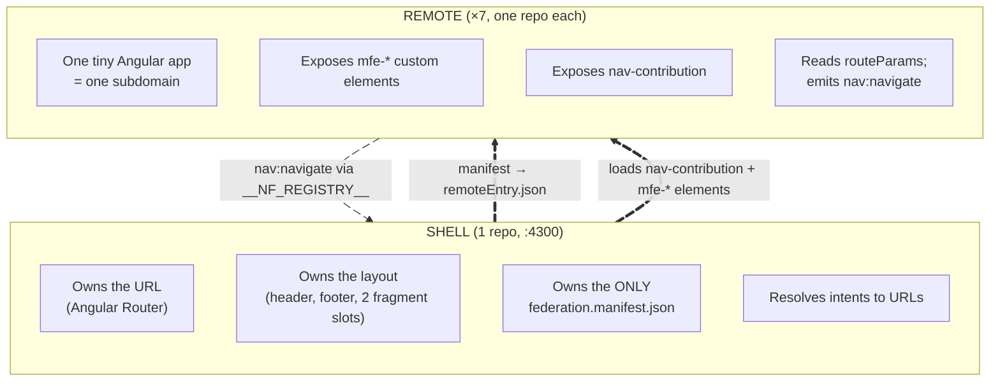
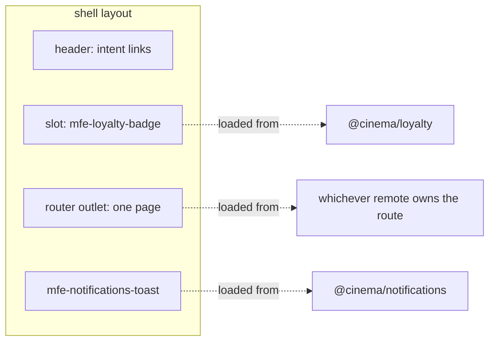

# Architecture

This document covers how eight independent repos become one page at
runtime. The mechanics are the tractor store's (see
[`../../tractor-store/docs/architecture.md`](../../tractor-store/docs/architecture.md)
and [`navigation.md`](../../tractor-store/docs/navigation.md)). This document
covers only what this demo keeps, what it drops, and what changes when there
is no monorepo.

## Shell and remotes



The one domain event, `booking:confirmed`, goes remote → remote (booking →
loyalty, notifications) over the same bus. The shell never subscribes to it.

### The shell

The shell is an application, not a subdomain. It holds **no domain data and
knows no domain events**.

- `main.ts`:
  - installs the event bus `window.__NF_REGISTRY__` (`??=`, as in the
    tractor store);
  - fetches `public/federation.manifest.json` with `no-cache`;
  - runs the orchestrator's `initFederation(manifest, { ...useShimImportMap({ shimMode: true }), hostRemoteEntry: './remoteEntry.json', ... })`.
    `hostRemoteEntry` puts the shell's own shared Angular in the import
    map, so its versions win (ADR-08);
  - on failure logs a fixed `console.error`. There is no `env.config.json`
    and no `showErrors` switch.
- `navigation.ts`, adapted from the tractor-store host:
  - loads every remote's `nav-contribution` with `Promise.allSettled`, so a
    remote that is down is skipped (with a `[nav]` warning);
  - builds one route per intent, mounted by one `RemoteShellComponent` that
    sets the tag and writes `routeParams`;
  - adds `**` as a **redirect** to `programme`, or to any parameterless
    page that did load. There is no "not available" page;
  - registers `nav:resolve` and handles `nav:navigate` with `replay: 0`;
  - the resolver is copied unchanged, with one addition: it
    **`console.warn`s on an unknown intent id or a missing param**. Without
    that, a misspelled id looks exactly like a remote that is down.
- `remote-element.ts`, adapted from the tractor store's remotes, mounts the
  two fragment slots. It also holds the remote loader, so the host's
  separate `load-remote.ts` is not copied.
- `RemoteShellComponent` writes **path params only** into `routeParams`, so
  `RouteParams` is `Record<string, string>`.
- The layout: a header with intent links to `programme.list`,
  `loyalty.points` and `account.profile`; the `mfe-loyalty-badge` slot;
  `mfe-notifications-toast`, mounted once; a footer; the global stylesheet.

### A remote

A remote is one Angular application, created once and shared by all of its
elements.

- `src/app.config.ts` exports `getAppInjector()`, which does
  `injector ??= createApplication(...)` (the tractor-store pattern). Every
  exposed element imports this module, so esbuild puts it in one shared
  chunk and the remote has exactly one injector. That is how loyalty's badge
  and page share one `PointsStore`.
- `src/bootstrap.ts` exports `bootstrap(): Promise<void>`. It calls
  `customElements.define(tag, createCustomElement(...))` for each element it
  owns. It takes no `env` and no `nf`: there is no env config, and no remote
  loads another remote, so **no remote imports the orchestrator at
  runtime** except in standalone `main.ts`.
- `federation.config.mjs` exposes one key per tag, and the key **is** the tag
  name. **Every** remote also exposes `nav-contribution`. Notifications has
  no pages, so its contribution is `{ basePath: 'notifications', intents: [] }`.
  That keeps the shell rule simple: a remote without a contribution is a
  broken remote, skipped with a `[nav]` warning.
- `src/main.ts` runs **only in standalone mode** (the shell loads
  `bootstrap.ts`, never `main.ts`). See
  [Local development](#local-development).
- No remote has a `federation.manifest.json` file. Standalone mode passes an
  inline empty manifest.

## Integration contracts: the complete list

There are five. Anything not on this list is private to one repo.

| # | Contract | Shape | Who agrees |
|---|---|---|---|
| 1 | **Manifest** | `@cinema/<team>` → `remoteEntry.json` URL; the key equals the remote's federation name | Shell and the deployment |
| 2 | **Exposed element** | Exposed key = tag name. Its module is a `RemoteElementModule`: `{ bootstrap(): Promise<void> }`. The shell's layout hard-codes two of these tags: `mfe-loyalty-badge` and `mfe-notifications-toast`. | Shell and each remote |
| 3 | **`nav-contribution`** | `{ basePath, intents: [{ id, path, element }] }` with a **local** `id` (`'plan'`); the shell builds the full id `basePath.id` (`seating.plan`) | Shell, every remote, and each caller of an intent |
| 4 | **`routeParams`** | One property the shell writes onto a routed element: **ids, plus the one documented `seats` string**. Param names equal the `{placeholders}` in the owner's path. | Shell, each page and each caller |
| 5 | **Bus events** | `nav:navigate`, `nav:resolve`, `booking:confirmed` | Producer and consumers |

The runtime contract is **strings**: tag names, exposed keys, intent ids,
param names, event names and the manifest's remote names. TypeScript types
only document those strings. How each contract is verified is in
[testing.md § Contract matrix](testing.md#contract-matrix).

### Naming conventions

No compiler checks names across repos, so every name carries its team's
prefix (Geers: "establish team prefixes").

| Thing | Pattern | Example |
|---|---|---|
| Federation name | `@cinema/<team>` | `@cinema/seating` |
| Tag = exposed key | `mfe-<team>-<thing>` | `mfe-seating-plan` |
| `basePath` = first URL segment | `<team>` | `/seating/...` |
| Intent id | `<team>.<thing>` | `seating.plan` |
| Domain event | `<team>:<past-tense-verb>` | `booking:confirmed` |
| Infrastructure event | `nav:<verb>` | `nav:navigate` |

Avoid names that stutter. `mfe-seating-plan` is fine. `mfe-seating-seat-plan`
is not.

### Intents

The tractor-store rule is kept: the URL is `/{basePath}/{path}`, so **each
team owns its URL prefix**, and no team's URL borrows another team's noun.

| Intent id | `basePath` + `path` | URL | Element | Params |
|---|---|---|---|---|
| `programme.list` | `programme` + `''` | `/programme` | `mfe-programme-list` | none |
| `film.detail` | `film` + `{filmId}` | `/film/{filmId}` | `mfe-film-detail` | `filmId` |
| `seating.plan` | `seating` + `{screeningId}` | `/seating/{screeningId}` | `mfe-seating-plan` | `screeningId` |
| `booking.checkout` | `booking` + `{screeningId}/{seats}` | `/booking/{screeningId}/{seats}` | `mfe-booking-checkout` | `screeningId`, `seats` |
| `loyalty.points` | `loyalty` + `''` | `/loyalty` | `mfe-loyalty-points` | none |
| `account.profile` | `account` + `''` | `/account` | `mfe-account-profile` | none |

`/` and every unknown URL redirect to `/programme` (see
[The shell](#the-shell)).

**The `seats` format** is the only structured value in a route:

- seat codes joined by commas, **sorted** by row letter, then by seat
  number (`A1,A2,B10`, never `A2,A1`);
- seating never emits an empty hold ("Continue" is disabled until a seat is
  held);
- booking treats an empty or unparsable value from a deep link as an empty
  checkout, and does not throw;
- the shell URL-encodes it, but Angular's router leaves `,` unescaped, so
  the address bar shows `/booking/s-101/A1,A2`. A typed `A1%2CA2` deep link
  works too. Booking receives the decoded value through `routeParams`.

The copied resolver also turns extra payload keys into a query string. The
demo simply does not use that, and the shell does not pass query params on
to `routeParams`.

### Events

| Event | Kind | Direction | Subscribe with |
|---|---|---|---|
| `nav:navigate` | command | any remote → shell | `replay: 0`: an old navigation must never be replayed |
| `nav:resolve` | resource (`register('nav:resolve', () => resolve)`) | shell → any `[navIntent]` | `onReady`: a link that renders late still gets the resolver |
| `booking:confirmed` | domain fact | booking → loyalty, notifications | `replay: 0`, see [ADR-05](decisions.md#adr-05-one-domain-event-replay-0-shell-mounted-consumers-only) |

## Fragments and resilience

There are exactly two cross-team fragments. Only the shell places them
([ADR-06](decisions.md#adr-06-cross-team-fragments-are-in-but-exactly-two-placed-only-by-the-shell)).



- The two fragments show the two flavours: one that **shows state** (the
  badge) and one that **reacts to events** (the toast).
- A fragment slot that fails to load **renders empty, with no error UI**
  (only a `[remote]` line in the console).
  The page around it keeps working, which is what Geers calls a resilient
  site.
- The badge and the `/loyalty` page are two elements of **one** loyalty
  application (see [A remote](#a-remote)). The `booking:confirmed`
  subscription lives in the root `PointsStore`, not in the badge, so the
  count is right whichever element is mounted first.

The copied `[navIntent]` directive keeps an unresolved link in the DOM but
removes its `href` and sets `aria-disabled="true"`: the link turns
**inert**. The shell resolver also logs a `[nav]` warning for it.

| Remote down | Effect |
|---|---|
| programme | `/` redirects to another parameterless page that loaded (`/loyalty` or `/account`). Deep links to other pages still work. |
| film | Film title links in the programme turn inert. |
| seating / booking | The links into that step turn inert. With booking down, seating's "Continue" stays on the page and the shell logs `[nav] cannot navigate` (console only, no UI). Nothing else breaks. |
| loyalty | The badge slot is empty, the header points link turns inert, and the booking still confirms. |
| notifications | No toast appears. Everything else works. |
| account | The header account link turns inert. This is the scripted walkthrough (see testing.md). |

## Sharing contracts without a monorepo

The tractor store imports `@tractor-store/contracts` through a tsconfig path
alias. A polyrepo cannot do that
([ADR-03](decisions.md#adr-03-contracts-are-copied-per-repo-not-published)).

**Each repo keeps its own `src/contracts.ts`, and copies only what it
touches.**

- The shell's copy is the reference. Every other copy starts with
  `// copied from shell/src/contracts.ts`.
- `src/contracts.ts` holds **types only**, imported with `import type`,
  never shared through federation (`sharedMappings: []`). Every copy also
  holds the `declare global { interface Window { __NF_REGISTRY__?: NFEventRegistry } }`
  augmentation, so the file is listed in the tsconfig `include` and not
  only reached through imports.
- Example values live in **`src/testing/contracts.examples.ts`**
  (`bookingConfirmedExample`, `seatsParamExample`), so production code
  imports no contract values.
- Copy rule: `Events` if the repo emits or subscribes; `NavPayload` and
  `NavResolver` if it has the directive; `NavContribution` in every remote;
  `RouteParams` if a page takes params; `BookingConfirmed` for booking,
  loyalty and notifications.
- Copied helpers, each from the tractor store, each **only where used**:

  | File | In |
  |---|---|
  | `src/shared/nav-intent.directive.ts` + its `.spec.ts` | shell, programme, film |
  | `src/testing/nav-resolver.stub.ts` | shell, programme, film |
  | `src/testing/setup.ts` (fresh real registry per test) | every repo |

- In production you would publish a types-only npm package as a
  devDependency instead.

```ts
// shell/src/contracts.ts (illustrative excerpt)
export interface BookingConfirmed { bookingRef: string; ticketCount: number }

// shell/src/testing/contracts.examples.ts
export const bookingConfirmedExample: BookingConfirmed = { bookingRef: 'BR-7F3A', ticketCount: 2 };
```

## Shared dependencies and versions

Each repo has its own lockfile, so nothing *guarantees* identical Angular
versions any more. That is the main new risk of a polyrepo, and the demo
shows it on purpose: film, notifications and account run Angular 21 next to
the shell's Angular 22, and share one Angular 21 through the `ng21` share
scope. The ranges, the
federation config and the verified drift behaviour are stated once, in
[ADR-08](decisions.md#adr-08-versions-are-aligned-by-convention).

**Package manager: npm**, per repo
([ADR-02](decisions.md#adr-02-polyrepo-with-no-root-workspace)).

## Local development

- Every repo: `npm install`, then `npm start` (`ng serve` on its fixed port,
  4300–4307). `npm test` runs Vitest.
- **Standalone mode** (remotes only). The remote's `main.ts`:
  1. installs a bus (`window.__NF_REGISTRY__ ??= createRegistry(...)()`);
  2. calls `initFederation({}, { ...useShimImportMap({ shimMode: true }), hostRemoteEntry: './remoteEntry.json' })`.
     The empty object is the manifest. The remote still needs
     `initFederation`, because its build externalizes Angular and the import
     map comes from its own `remoteEntry.json`;
  3. sets fixed `routeParams` on the element that `src/index.html` mounts,
     for example `{ screeningId: 's-101' }` (before the upgrade, so the
     first render has them), then imports `./bootstrap` and calls
     `bootstrap()`.

  Links stay inert, because there is no shell to resolve intents. Standalone
  mode is for working on one element. It is not production.
- **Everything at once:** `./start-all.sh` at the example root:
  - runs `npm --prefix <repo> install` **one repo after another** (parallel
    installs fight over the npm cache);
  - then starts all eight `npm start`s in parallel under
    `trap 'kill 0' EXIT; ...; wait`, so Ctrl-C stops them all, with every
    log line prefixed by the repo name.

  The honest cost: eight `node_modules` folders (several GB) and the memory
  of eight dev servers.
- The example root has **no `package.json` and no workspace file**. Adding
  either would quietly turn the polyrepo back into a monorepo.

## Deployment

- Each repo builds to its own static folder and can be deployed on its own.
- The **shell's `federation.manifest.json` is the only file where the repos
  meet at deploy time**
  ([ADR-07](decisions.md#adr-07-the-shell-owns-the-only-manifest-no-cdn-no-env-config)).
  - The dev manifest, with localhost ports, is checked into
    `shell/public/`.
  - A deployment replaces that file with the environment's URLs.
- Example dev manifest:

  ```json
  {
    "@cinema/programme": "http://localhost:4301/remoteEntry.json",
    "@cinema/film": "http://localhost:4302/remoteEntry.json",
    "...": "one line per remote, 7 in total"
  }
  ```

- CI is out of scope for the first version. In real life there is one
  pipeline per repo; the shell's pipeline owns the manifest and runs
  `npm run smoke` after rewriting it (see testing.md).

## Assets

Each repo serves its own `public/`. The shell serves the global CSS,
including the one Angular Material M3 theme. Elements use no shadow DOM, so
its `--mat-sys-*` tokens style every remote; a remote includes the same
theme in its own `styles.scss` only for standalone mode.
Posters are text or emoji, so there is no image loader.
