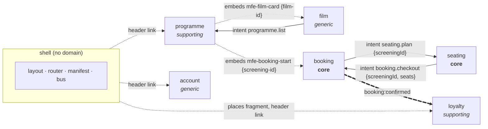

# Domain

This document describes the business the demo is about and where its
boundaries are. It follows the domain-slicing reasoning: name the
subdomains first, find the actors and the pivotal events, and then slice
the domain so that **one MFE equals one bounded subdomain**.

## Why a cinema

- **Nobody needs it explained.** Every developer has booked a cinema seat.
- **All three subdomain types appear naturally.** None of them has to be
  forced.
- **The same real-world thing changes name across contexts.** That is the
  bounded-context lesson in one sentence: a *film* in the catalogue becomes
  a *screening* in the programme, and a *seat* in the hall becomes a
  *ticket* in a booking, which becomes *points* in loyalty.
- **It has one obvious pivotal event**, a booking being confirmed. That is
  enough to show the event bus without inventing a workflow.

## Domain story

A **moviegoer** opens the cinema site and sees the **programme**: this
week's **screenings**, each showing its **film** and what a seat costs.
They may open a film to read its synopsis. They **book** a screening, which
opens the **seat plan**, and **hold** two free **seats**. They continue to
the **checkout**, see two **tickets** at a flat price and **confirm**. The
confirmed **booking** gets a reference. The moviegoer earns **points**, and
the points badge in the header ticks up. They can also look at their **account**, but
nobody does that for fun.

## Actors

| Actor | Description |
|---|---|
| **Moviegoer** | The only actor. Anonymous and single-user. There is no sign-in. |

Out of scope: cinema staff, programme planners who schedule screenings, and
admins. These actors would bring write models into programme and film, and
the demo does not need them.

## Ubiquitous language

| Term | Owner (subdomain) | Meaning |
|---|---|---|
| film | film | Catalogue content: title, poster, synopsis, runtime, age label. It has no time and no place. |
| screening | programme | One film (by `filmId`) shown at one day and time in the hall. Elsewhere it is referenced only by `screeningId`. |
| programme | programme | The list of screenings this week. |
| seat | seating | A physical place in the hall, coded `A1` to `E8`. It is `free`, `taken` or `held`. |
| hold | seating | The seats the moviegoer selected for one screening, before checkout. It lives in the URL once it leaves seating. |
| checkout | booking | The page that turns a hold into tickets and, on confirm, into a booking. |
| ticket | booking | The right to one seat at one screening. Each ticket costs a flat €12, a price only booking knows. |
| booking | booking | A confirmed set of tickets, identified by a `bookingRef` such as `BR-7F3A`. |
| points | loyalty | 10 per ticket. Kept in memory and reset on reload. |
| profile | account | The moviegoer's mock name and email. |

Each term has exactly one owner. Other subdomains may *mention* a term only
by its id (`screeningId`, `bookingRef`) or through an event snapshot. They
never look the term up in the owner's data.

## Subdomain map

| Subdomain | Type | Remote | Why this type | Aggregate (mock data) |
|---|---|---|---|---|
| **Seat selection** | **core** | seating | Choosing your own seat is what sets this cinema apart. | SeatPlan per screening (read-only; taken seats are deterministic per `screeningId`) |
| **Booking** | **core** | booking | Turns a hold into revenue. | Booking (in memory) |
| Screenings | supporting | programme | Specific to this cinema, but simple: what's on and when. | Screening (read-only list) |
| Loyalty | supporting | loyalty | Specific to this business: rewards for coming back. | PointsAccount (in memory) |
| Film catalogue | generic | film | In real life, film metadata is bought from a distributor or a metadata provider. | Film (read-only) |
| Identity | generic | account | In real life this is an off-the-shelf identity provider. | Profile (read-only) |
| *(composition)* | none | shell | Not a subdomain: menu, routes, slots, the remote switcher. | none |

*Film* could be seen as supporting rather than generic. It is kept generic
because the demo needs an example of "buy, don't build", and the
classification does not change the boundaries.

A toast is **not** a subdomain: it has no actor goal, no vocabulary and no
data of its own, and you can describe it without naming a cinema concept.
That is why the notifications remote was removed
([ADR-15](decisions.md#adr-15-pages-may-embed-declared-fragments-the-shell-defines-them)).

The generic MFEs are **nearly empty on purpose**. They show that the
smallest possible remote is one `nav-contribution` plus one element.

## Pivotal event

There is one event: **BookingConfirmed**.

| Event | Producer | Consumers | Payload (snapshot) |
|---|---|---|---|
| `booking:confirmed` | booking | loyalty | `{ bookingRef, ticketCount }` |

- The producer does not know its consumers. Adding a third consumer means
  no change to booking.
- The payload is a **snapshot**: it holds everything the consumers need
  (loyalty counts tickets), so no consumer has to call booking back.
- How it is subscribed, and who may consume it, is decided once in
  [ADR-05](decisions.md#adr-05-one-domain-event-sent-as-a-command-shell-mounted-consumers-only).

**SeatsHeld is a pivotal moment but not an event.** The hold travels to
booking **in the URL** (`/booking/{screeningId}/{seats}`), see
[ADR-04](decisions.md#adr-04-the-hold-travels-in-the-url-not-on-the-bus).

## Context map

These arrows are the complete set of ways subdomains meet:

- **Thin arrows: intents.** One team links to another team's page by
  intent id plus ids. It never knows the other team's URL. The booking ↔
  seating cycle is intended (ADR-15).
- **Thick arrows: the event.** A fact is published once and consumed by
  anyone who cares.
- **Dotted arrows from programme: embeds.** Programme's page places
  another team's fragment and passes it one id as an attribute.
- **Dotted arrows from the shell.** It places fragments and header links. It
  holds no domain data, and its code never subscribes to or emits a domain
  event (its `contracts.ts` only holds the reference types, ADR-03).

## Boundaries: what each MFE owns, and what it must not do

| MFE | Owns | Must not |
|---|---|---|
| programme | Screenings: `screeningId` → `filmId`, day and time. The landing page that assembles the card. | Hold any film content (not even the title), know prices, or know seat availability |
| film | Film content, the film card and the detail page | Know when a film is screened (that belongs to programme) |
| seating | Seat plans and the current hold (local state) | Price anything, or create bookings |
| booking | The price per seat, `bookingRef`, the confirmation, and the call to action that starts a booking | Know seat plans or film content, or award points |
| loyalty | The points total | Know prices or seats. It only counts tickets from the event. |
| account | The mock profile | Hold bookings or points |

Shared identifiers each have one owner: `filmId` is film's (programme
references it), and `screeningId` is programme's (booking and seating
reference it). Seating's taken-seats map is keyed by `s-101…`; that is a
documented simplification, not a second owner.

## Slicing: pages vs fragments

Following the domain-slicing rule, *a page is a destination the user
navigates to, and a fragment is a piece placed inside someone else's page*.

- **Pages (6):** `mfe-programme-list`, `mfe-film-detail`,
  `mfe-seating-plan`, `mfe-booking-checkout`, `mfe-loyalty-points`,
  `mfe-account-profile`.
- **Fragments (3):**
  - `mfe-loyalty-badge`, placed by the shell in its `header` slot (shows
    state);
  - `mfe-film-card` (film) and `mfe-booking-start` (booking), embedded by
    programme in each screening card.

So one programme card is rendered by three teams' apps on two Angular
majors: programme's day and time (22), film's card (21) and booking's Book
link (22).

Booking's confirmation is a **state of the checkout page**, not a second
page. That keeps the busiest MFE to one element.
