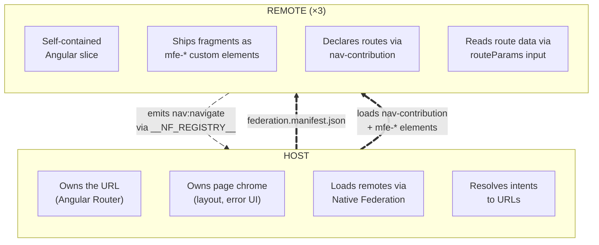
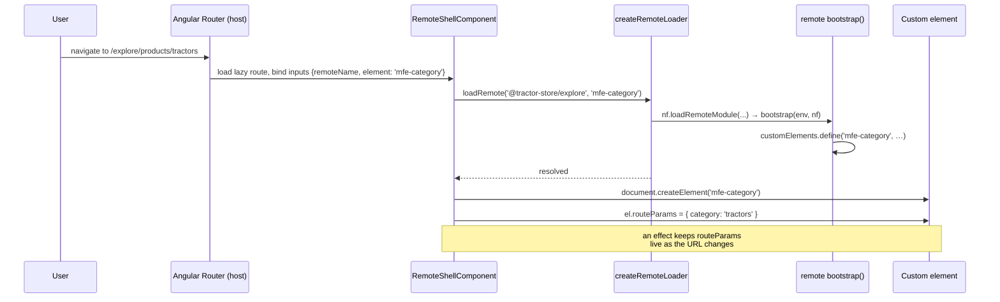
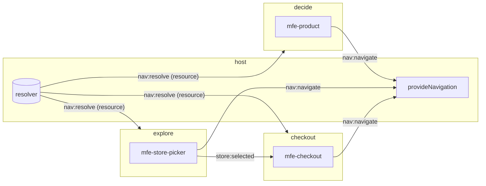
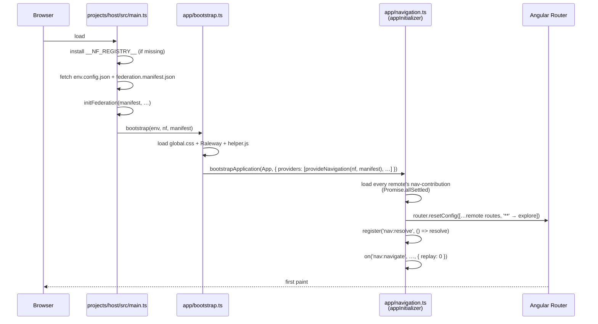

# Architecture

This document explains the contract between the host and the remotes —
what each side owns, where the boundary sits, and how the three
decoupling mechanisms (custom elements, the event bus, intent-based
navigation) make runtime composition possible without coupling the apps
together. A short note on the contracts library closes it out.

## Why decoupling matters

Three teams ship three Angular applications into one page. The
architecture has one job: keep those teams independent. _Independent_
means a team can rename a route, swap an internal component, or roll a
backend change forward without coordinating with the other teams.

Whenever two MFEs talk to each other directly — by importing types,
sharing a `Router`, or calling each other's services — they pick up a
hidden dependency that turns "deploy whenever you want" into "deploy
whenever the other team is ready". The architecture below avoids that
by inserting an explicit, stable contract at every place where the apps
meet.

> Michael Geers, _micro-frontends.org_: "_Isolate Team Code — Don't
> share a runtime, even if all teams use the same framework. Build
> independent apps that are self-contained._"

## The two-layer model

Two layers, with a small, explicit contract between them.



The contract has exactly four touchpoints:

1. **`federation.manifest.json`** — the host's list of remote names →
   entry URLs, fetched at startup.
2. **`nav-contribution`** — a module each remote _exposes_ that
   declares its base path and the intents (routable destinations) it
   owns.
3. **`mfe-*` custom elements** — the actual UI fragments, also exposed
   via federation. The host instantiates them with
   `document.createElement`.
4. **`routeParams`** — a single property the host writes onto a
   mounted custom element, carrying parsed path and query parameters.

Nothing else is shared at the boundary. There is no `import` from a
remote in host code, no Angular service crossing the line, no shared
router state.

## The three decoupling mechanisms

### 1. Custom elements as the integration surface

A remote does not ship Angular components for the host to import. It
ships **custom elements** (web components) registered under stable
`mfe-*` tags via `@angular/elements`.

Each remote creates its Angular application in `app.config.ts`, and
every exposed element has a `bootstrap.ts` that defines its tag on top
of that application:

```ts
// projects/explore/src/app.config.ts
let injector: Promise<Injector> | undefined;

export const getAppInjector = (env: EnvironmentConfig, nf: NativeFederationResult): Promise<Injector> =>
  (injector ??= createApplication({
    providers: [
      provideZonelessChangeDetection(),
      { provide: IMAGE_LOADER, useValue: cdnImageLoader(env.cdnUrl) },
      { provide: LOAD_REMOTE, useValue: createRemoteLoader(env, nf) },
    ],
  }).then((app) => app.injector));

// projects/explore/src/features/header/bootstrap.ts
export const bootstrap = async (env: EnvironmentConfig, nf: NativeFederationResult): Promise<void> => {
  const injector = await getAppInjector(env, nf);
  if (customElements.get('mfe-header')) return;
  customElements.define('mfe-header', createCustomElement(HeaderComponent, { injector }));
};
```

This code is deliberately repeated in every remote rather than hidden
behind a shared helper. Open any `bootstrap.ts` and the whole path from
"the host asked for `mfe-header`" to "the tag is defined" is on screen.

The browser's standard custom-element machinery does the integration.
Four consequences worth calling out:

- **Plain HTML is the contract.** A consumer drops `<mfe-cart>` in a
  template; nothing else is required. No Angular type, RxJS Observable,
  or service interface crosses the boundary.
- **One Angular per remote.** `getAppInjector` creates the remote's
  application on the first bootstrap and caches the promise in a
  module-level `let`. Every element of that remote reuses the same
  injector. When explore's header shows `<mfe-mini-cart>` and decide's
  product page shows `<mfe-add-to-cart>`, both elements come from
  checkout and share one `CartStore`. Nothing leaks across remotes,
  because each remote has its own `app.config.ts` module.
- **Bootstrap is idempotent.** Each `bootstrap.ts` checks
  `customElements.get(tag)` _after_ awaiting the injector, and the
  remote loader checks it before loading. So it is safe to request the
  same fragment from many places at once: only the first call defines
  the element.
- **Shadow DOM at the boundary only.** The exposed root components
  (the `mfe-*` pages and fragments) use `ViewEncapsulation.ShadowDom`.
  Internal components (button, tiles, line items, …) keep Angular's
  default emulated encapsulation; Angular copies their styles into the
  root's shadow root.

> Cam Jackson, _martinfowler.com_: "_Each micro frontend is to define
> an HTML custom element for the container to instantiate, instead of
> defining a global function for the container to call._"

#### Loading a fragment: `LOAD_REMOTE`

Every app that embeds another team's element has the same small loader:
`projects/host/src/app/load-remote.ts` in the host, and
`src/shared/remote-element.ts` in each remote.

```ts
export const createRemoteLoader =
  (env: EnvironmentConfig, nf: NativeFederationResult) =>
  async (remoteName: string, element: string): Promise<void> => {
    if (customElements.get(element)) return;
    const mod = await nf.loadRemoteModule<RemoteElementModule>(remoteName, element);
    await mod.bootstrap(env, nf);
  };
```

The loader lives in DI under the `LOAD_REMOTE` token. The host provides
it in `app/bootstrap.ts`, and each remote provides it in its own
`app.config.ts`. Components never call it by hand. In the remotes, they
put `RemoteElementDirective` (also in `shared/remote-element.ts`) on the
tag they want to embed, and the directive loads that element from the
named remote:

```html
<mfe-header mfeRemote="@tractor-store/explore"></mfe-header>
```

The loader hands `nf` (the federation runtime) to the remote's
bootstrap, and that remote builds its own loader from it. That is how
cross-remote loads work even when the host is not in the picture:
explore's header can contain
`<mfe-mini-cart mfeRemote="@tractor-store/checkout">` and it just
works.

#### Why a single `routeParams` property and not attributes

`HTMLElement` reserves a long list of property names (`id`, `slot`,
`title`, `hidden`, `style`, …). If the host wrote each route param as
its own attribute or property it would silently collide with
intrinsics — set `<mfe-cart id="abc">` and Angular would happily read
`''` because the DOM already owns `id`. Instead, all params land under
one well-known property (`routeParams`, typed as `RouteParams` in
`libs/contracts/index.ts`). A routed page declares it as an input,
`readonly routeParams = input<RouteParams>({})`, and reads the keys it
needs. Clean separation, zero collisions.

#### How a route activation lands a custom element on the page



`RemoteShellComponent` (`projects/host/src/app/remote-shell.component.ts`)
follows exactly this script. `remoteName` and `element` are inputs
bound from the route data (`withComponentInputBinding`). A
`resource()` calls the loader and creates the element; while it is
loading the shell shows a spinner, and if the load fails it shows an
error message. `paramMap` + `queryParamMap` become signals
(`toSignal`) that a `computed` merges into one `routeParams` object.
Its `equal` function compares the values, so the element only sees a
new object when a value actually changed. An `effect` mounts the element and
assigns `routeParams`.

### 2. The event bus (`window.__NF_REGISTRY__`)

Custom elements solve composition: a remote can mount another remote's
UI. But composition alone is not enough — the remotes also need to
_talk_ to each other. They do that through a small, shared event bus
that each app's `main.ts` installs before Angular bootstraps.

The bus lives on `window.__NF_REGISTRY__`. In these docs it is always
called _the event bus_. It is created at
the top of every app's `main.ts`, so a remote running standalone gets a
bus too:

```ts
window.__NF_REGISTRY__ ??= Object.freeze(
  createRegistry({ maxStreams: 20, maxEvents: 1, removePercentage: 0.25 })(),
);
```

It is the [event registry][nf-registry] of the Native Federation
orchestrator: event streams (`emit(name, data)` / `on(name, handler)`)
plus latched resources (`register(name, value)` / `onReady(name,
handler)`). The apps call it directly; there is no wrapper around it.
What the teams agree on is the `Events` interface in
`libs/contracts/index.ts`, which maps every event name to its payload
type:

```ts
// libs/contracts/index.ts
export interface Events {
  'nav:navigate': NavigatePayload;
  'nav:resolve': NavResolver;
  'store:selected': StoreSelectedPayload;
}
```

Emitting and listening look the same in every app:

```ts
// projects/explore/src/features/store-picker/store-picker.component.ts
window.__NF_REGISTRY__!.emit<Events['store:selected']>('store:selected', { id: store.id });

// projects/checkout/src/features/checkout/checkout.page.ts
const stop = window.__NF_REGISTRY__!.on<Events['store:selected']>(
  'store:selected',
  ({ data }) => this.form.controls.storeId.setValue(data.id),
);
inject(DestroyRef).onDestroy(stop);
```

`on` replays the last event to a new subscriber by default. The host
subscribes to `nav:navigate` with `{ replay: 0 }`, because a navigation
command must never be replayed. `nav:resolve` is a resource, so a link
that renders after the host published it receives it at once.

> **Gotcha:** `register(name, value)` treats a function `value` as a
> provider and stores what it _returns_. The host publishes its resolver
> function as `register('nav:resolve', () => resolve)`.

[nf-registry]: https://native-federation.com/docs/v4/orchestrator/event-registry

The type parameter (`Events['store:selected']`) makes a payload that
doesn't match the contract a compile-time error. The event name itself
is still a string, so keep it next to the type in `Events` and search
for it when you rename it.

> Cam Jackson, _martinfowler.com_: "_Custom events allow micro
> frontends to communicate indirectly, which is a good way to minimise
> direct coupling, though it does make it harder to determine and
> enforce the contract that exists between micro frontends._"

The `Events` interface is the answer to Jackson's caveat: every event's
contract is in one file that both ends import as a type.

#### The channels in use today



| Event            | Direction                 | Purpose                                                                       |
| ---------------- | ------------------------- | ----------------------------------------------------------------------------- |
| `nav:navigate`   | remote → host             | Intent-based navigation requests (from `[navIntent]` or emitted directly)      |
| `nav:resolve`    | host → remotes (resource) | The `NavResolver` (`(id, payload) => url \| null`) so links render real `href`s |
| `store:selected` | explore → checkout        | Notify checkout when the user picks a pickup store                            |

All three are typed in `libs/contracts/index.ts` (`Events`).

State that stays inside one remote does not need the bus. All of
checkout's elements (`<mfe-cart>`, `<mfe-mini-cart>`,
`<mfe-add-to-cart>`, …) share one Angular application, so they share
one `CartStore` and its signals keep them in step. A second browser
tab is kept in sync by `CartStore` listening to the window's `storage`
events (`projects/checkout/src/data/cart-store.ts`).

The pattern generalises: when two MFEs need to coordinate on a piece
of state, add the event and its payload type to `Events` and use the
registry on both sides. No singleton service, no shared DI tree, no
shared runtime code.

### 3. Intent-based navigation

Custom elements compose UI. The event bus carries state. The
_navigation_ problem is bigger than either: every team wants to link
to pages owned by other teams, without hard-coding URLs that those
other teams may rename.

Each remote declares a `nav-contribution`
(`projects/<remote>/src/nav-contribution.ts`) listing its routable
intents:

```ts
// projects/checkout/src/nav-contribution.ts
export const navContribution: NavContribution = {
  basePath: 'checkout',
  intents: [
    { id: 'cart', path: '/cart', element: 'mfe-cart' },
    { id: 'checkout', path: '/checkout', element: 'mfe-checkout' },
    { id: 'thanks', path: '/thanks', element: 'mfe-thanks' },
  ],
};
```

The remote owns relative intent IDs (`cart`, `checkout`, `thanks`).
The host prepends each contribution's `basePath` when it registers
them, producing the public IDs other teams link to (`checkout.cart`,
etc.). Remotes link by intent, never by URL, and each remote's
`[navIntent]` directive makes that ergonomic in templates. Full
walkthrough in [navigation.md](./navigation.md).

> Cam Jackson, _martinfowler.com_: "_Using the page URL for this
> purpose ticks many boxes … It's declarative, not imperative.
> I.e. 'this is where we are', rather than 'please do this thing'._"

The intent layer is what makes that declarative-URL model work
_without_ every team having to know every other team's URL scheme.

## The bootstrap chain

How a host page comes alive, end to end:



Every app's `main.ts` does the same three steps; only the last line
differs. The host bootstraps its Angular app, a standalone remote
bootstraps its default page with `bootstrap(env, nf)`. `main.ts`
statically imports only the orchestrator: it runs before the import map
exists, so Angular is only reached through the dynamically imported
bootstrap. Two artefacts drive everything, both fetched with
`cache: 'no-cache'`:

- **`env.config.json`** — per-environment values: `cdnUrl` and
  `production` (`EnvironmentConfig` in `libs/contracts/index.ts`). Same shape across all four apps. CI rewrites
  it for the deployed environment, so the same build works locally
  and on GitHub Pages.
- **`federation.manifest.json`** — the discovery file:

  ```json
  {
    "@tractor-store/explore": "http://localhost:4201/remoteEntry.json",
    "@tractor-store/decide": "http://localhost:4202/remoteEntry.json",
    "@tractor-store/checkout": "http://localhost:4203/remoteEntry.json"
  }
  ```

  Each value is the URL of a remote's `remoteEntry.json` — the
  import-map fragment Native Federation publishes during build.
  `initFederation` merges all of them into the page's import map so
  any subsequent `nf.loadRemoteModule(remoteName, exposedModule)`
  resolves to the right bundle.

`__NF_REGISTRY__` is installed _before_ federation init, so remotes
that touch the bus during their own bootstrap always find it there.

## Native Federation vs. Module Federation

Native Federation is the standards-based alternative to webpack's
Module Federation. It implements the same mental model — remotes
publish a `remoteEntry`, the host imports modules from named remotes
at runtime — on top of ECMAScript Modules and Import Maps instead
of webpack runtime, so it works with esbuild/Vite/Rspack and aligns
with Angular 17+'s default builder.

> Manfred Steyer, _Announcing Native Federation 1.0_: "_Native
> Federation brings the proven mental model of webpack Module
> Federation to the browser — built on ESM and Import Maps,
> independent of any specific build tool._"

This workspace uses
[`@angular-architects/native-federation`](https://www.npmjs.com/package/@angular-architects/native-federation)
plus `@softarc/native-federation-orchestrator` (the runtime that
ships `createRegistry`, the event bus we attach to `__NF_REGISTRY__`).

## Contracts, not a shared library

The apps share **no runtime code**. Every piece of wiring (the
bootstrap, the remote loader, the link directive, the button) lives
in the app that uses it, even when that means three copies. That keeps
each app readable on its own and lets each team change its copy
without coordinating a release with the others.

What the teams _do_ agree on lives in one types-only file,
`libs/contracts/index.ts`, imported as `@tractor-store/contracts`:

| Type                                          | Agreed between                                      |
| --------------------------------------------- | --------------------------------------------------- |
| `EnvironmentConfig`                           | every app's `env.config.json`                       |
| `RemoteElementModule`                         | the loaders and every exposed `bootstrap.ts`        |
| `NavContribution`, `NavIntent`                | each remote's `nav-contribution.ts` and the host    |
| `NavPayload`, `NavResolver`, `RouteParams`    | the host's navigation and the remotes' pages/links  |
| `Events` (+ payload types), `window.__NF_REGISTRY__` | everyone on the event bus                     |

Because it is imported with `import type` only, it compiles away:
nothing from it exists at runtime and nothing needs to be shared
through federation. Each app's `federation.config.mjs` therefore has an
empty `sharedMappings` (`projects/host/federation.config.mjs`):

```js
shared: fromPackageJson({ singleton: true, strictVersion: true, requiredVersion: 'auto', build: 'package' })
  .patch(['@angular/*'], { includeSecondaries: { keepAll: true } })
  .get(),
sharedMappings: [],
skip: ['rxjs/ajax', 'rxjs/fetch', 'rxjs/testing', 'rxjs/webSocket'],
```

What the flags mean:

- **`singleton: true` on every package dependency, Angular included.**
  Exactly one `@angular/core` on the page. Without this, two copies of
  Angular would each have their own injector tree roots and DI would
  silently break across remotes. `strictVersion: true` makes a version
  mismatch fail loudly at load time instead of producing weird runtime
  bugs.
- **`includeSecondaries: { keepAll: true }` on `@angular/*`.** Publishes
  every secondary entry point (`@angular/core/rxjs-interop`,
  `@angular/common/http`, …) as shared, so a remote that imports one the
  host doesn't still gets the shared copy instead of loading its own
  Angular.
- **`sharedMappings: []`.** Left out, Native Federation would share
  every TypeScript path alias in `tsconfig.json`. There is nothing to
  share, so it is turned off explicitly.
- **`skip`** trims rxjs sub-entries that aren't used at runtime,
  cutting the shared bundle.

> Cam Jackson, _martinfowler.com_: "_The most obvious candidates for
> sharing are 'dumb' visual primitives such as icons, labels, and
> buttons. … Be careful to ensure that your shared components contain
> only UI logic, and no business or domain logic. When domain logic
> is put into a shared library it creates a high degree of coupling
> across applications._"

This demo goes one step further than Jackson's advice and doesn't even
share the dumb primitives: explore and checkout each have their own
button. For a demo, seeing every app's flow in one place is worth more
than the saved lines. A real product with a design system would
publish it as a versioned npm package and share it through `shared`,
not through a path alias.

## Team boundary visualisation

Each team has a colour:

| Team     | Hex       | Owns                      |
| -------- | --------- | ------------------------- |
| Explore  | `#FF5A54` | Catalog, header, footer   |
| Decide   | `#53FF90` | Product detail            |
| Checkout | `#FFDE54` | Cart, checkout, mini-cart |

The CDN ships a small overlay script (`public/cdn/js/helper.js`,
loaded by the host at bootstrap). It looks for `data-boundary` and
`data-boundary-page` attributes on rendered DOM and, when
`html.showBoundaries` is set, draws coloured boxes around each team's
contribution. It is a debugging aid for seeing at a glance which team
owns which pixel. The only _enforcement_ of team boundaries is the
build: each app compiles on its own, so a remote cannot import code
from another remote, only the types in `@tractor-store/contracts`.

## See also

- [Navigation](./navigation.md) — how the intent system makes the
  boundary navigable without coupling.
- [Features](./features.md) — concrete catalogue of what each remote
  ships and which events it speaks.
