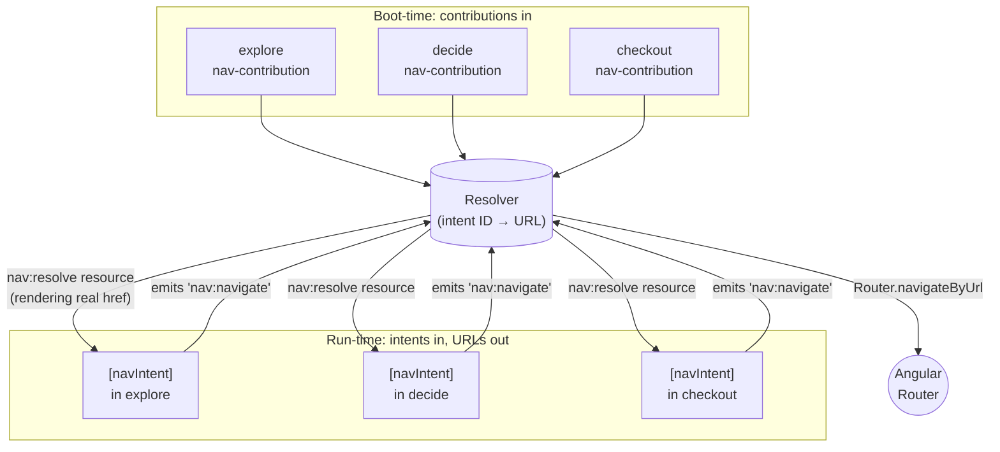
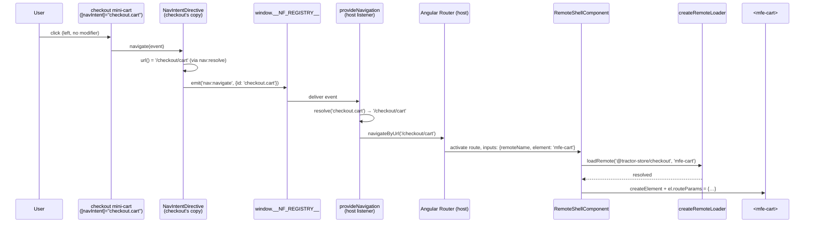

# Navigation

The Tractor Store has *one* router (in the host) and *zero* hard-coded
cross-team URLs in the remotes. A click in `decide` that should land
on the cart never mentions `/checkout/cart` — it emits the **intent**
`checkout.cart` and lets the host figure out the URL.

This document walks through how that works, why the intent system is
the load-bearing piece of the host/remote decoupling, and how a click
in one remote becomes a route activation in another.

## The problem with the obvious solutions

In a naïve micro-frontend setup, remote A linking to remote B picks
one of two bad options:

- **Hard-code the URL.** Now A breaks every time B reorganises its
  routes, and renaming `/checkout` becomes a coordinated multi-team
  migration.
- **Import B's routing module.** Now A and B are build-time coupled,
  share a router instance, and can't deploy independently.

Both options leak B's URL scheme into A. The intent system removes
the leak entirely by letting each remote keep ownership of its URLs
while exposing a stable, public name (the intent) to the rest of the
world.

If you're familiar with Android's deep-link Intents, the model is the
same: the caller names *what* it wants to reach, the platform decides
*where* that lives.

## The contract: `nav-contribution`

Each remote *exposes* (via `federation.config.mjs`) a
`nav-contribution` module. It is a single object describing what the
remote routes (`projects/explore/src/nav-contribution.ts`):

```ts
export const navContribution: NavContribution = {
  basePath: 'explore',
  intents: [
    { id: 'home',              path: '/',                    element: 'mfe-home' },
    { id: 'products',          path: '/products',            element: 'mfe-category' },
    { id: 'products.category', path: '/products/{category}', element: 'mfe-category' },
    { id: 'stores',            path: '/stores',              element: 'mfe-stores' },
  ],
};
```

The shape (`NavContribution` in `libs/contracts/index.ts`) carries no
remote name; the host already knows it from the manifest key:

- `basePath` — the URL prefix the host will mount the remote under
  (`/explore`, `/decide`, `/checkout`).
- `intents[]` — every destination the remote owns:
  - `id` — the public name *relative to the remote*. The host prepends
    `basePath`, so `explore`'s `{ id: 'home' }` becomes the public
    `explore.home`. Other remotes link to the full ID, never to a URL.
  - `path` — the path *inside* `basePath`, with optional `{param}`
    segments. The host turns these into Angular's `:param` form when it
    registers routes, so the contribution stays framework-neutral.
  - `element` — the `mfe-*` custom element to render at that path.
    Intents without one are link-only.

The full intent ID is the only thing that crosses team boundaries.
URLs and element tags are an implementation detail of the owning
team. Each remote has a spec (`src/nav-contribution.spec.ts`) that
checks every `element` is actually listed in its `exposes`, because
the host loads it with `loadRemoteModule(remoteName, element)`.

## Boot-time wiring

When the host starts, it loads every remote's `nav-contribution` in
parallel and uses them to build its router config and a _resolver_: a
function that turns an intent ID plus payload into a URL.

All of it lives in one file,
`projects/host/src/app/navigation.ts`, which reads top to bottom:

```ts
export const provideNavigation = (
  nf: NativeFederationResult,
  manifest: FederationManifest,
): EnvironmentProviders =>
  provideAppInitializer(async () => {
    const router = inject(Router);
    const registry = window.__NF_REGISTRY__!;
    const contributions = await loadContributions(nf, manifest);

    router.resetConfig([
      ...toRoutes(contributions),
      { path: '**', redirectTo: 'explore' },
    ]);

    const resolve = createResolver(contributions);
    // see Events['nav:resolve']
    await registry.register<Events['nav:resolve']>('nav:resolve', () => resolve);

    registry.on<Events['nav:navigate']>(
      'nav:navigate',
      ({ data: { id, payload } }) => {
        const url = resolve(id, payload);
        if (url === null) console.error(`[nav] cannot navigate to "${id}"`);
        else void router.navigateByUrl(url);
      },
      { replay: 0 },
    );
  });
```

It does four things:

1. **Loads contributions.** `loadContributions` uses
   `Promise.allSettled`, so a broken remote does not break the whole
   shell. It is skipped with a console warning.
2. **Resets the Angular Router config** with one route per intent that
   has an `element`. Every route lazy-loads the same
   `RemoteShellComponent`; only the route data differs:

   ```ts
   {
     path: 'explore/products/:category',
     loadComponent: () => import('./remote-shell.component').then((m) => m.RemoteShellComponent),
     data: { remoteName: '@tractor-store/explore', element: 'mfe-category' },
   }
   ```

3. **Publishes the resolver as `nav:resolve`.** It is a registry
   _resource_, so a link that renders later still receives it at once.
   The remotes use it to render real `href` attributes on anchors (so
   middle-click, "copy link", and screen-reader URL announcements
   work). `register()` would call a function argument as a provider,
   hence `() => resolve`.
4. **Handles `nav:navigate`.** Every `[navIntent]` click and every
   programmatic navigation in any remote lands here, is resolved, and
   hits the Router. It subscribes with `replay: 0`, so an old command
   is never replayed.

Because all of this runs in one `provideAppInitializer`, by the time
the user sees the first frame the resolver is published and routing is
wired.

## The host as the hub



Contributions flow into the host once, at startup. The host then
publishes its resolver so the remotes can render real anchors. After
that, every click in every remote routes through the single
host-owned listener. Remotes only ever speak the public intent ID; all
URL knowledge, including how `{param}` templates are filled in, stays
in the host.

## Linking from a remote: `[navIntent]`

Remotes never type a URL and never inject `Router`. Each remote that
renders links has its own `NavIntentDirective`
(`src/shared/nav-intent.directive.ts`; the copies in explore, decide
and checkout are identical, and so are their specs):

```html
<a [navIntent]="'checkout.cart'">Cart</a>

<a [navIntent]="'decide.product'" [navPayload]="{ id: product.id }">
  See details
</a>
```

The whole directive:

```ts
@Directive({
  selector: '[navIntent]',
  host: {
    '[attr.href]': 'isAnchor ? url() : null',
    '[attr.aria-disabled]': 'url() === null ? "true" : null',
    '(click)': 'navigate($event)',
  },
})
export class NavIntentDirective {
  readonly navIntent = input.required<string>();
  readonly navPayload = input<NavPayload>({});

  private readonly resolve = signal<NavResolver | undefined>(undefined);
  protected readonly isAnchor =
    inject<ElementRef<HTMLElement>>(ElementRef).nativeElement.tagName === 'A';
  protected readonly url = computed(
    () => this.resolve()?.(this.navIntent(), this.navPayload()) ?? null,
  );

  constructor() {
    const stop = window.__NF_REGISTRY__!.onReady<Events['nav:resolve']>(
      'nav:resolve',
      (resolve) => this.resolve.set(resolve),
    );
    inject(DestroyRef).onDestroy(stop);
  }

  protected navigate(event: MouseEvent): void {
    // Leave new-tab and new-window clicks on real links to the browser.
    if (this.isAnchor && isModifiedClick(event)) return;
    if (this.url() === null) return;
    event.preventDefault();
    window.__NF_REGISTRY__!.emit<Events['nav:navigate']>('nav:navigate', {
      id: this.navIntent(),
      payload: this.navPayload(),
    });
  }
}
```

That is what makes anchors behave naturally. A plain left-click is
intercepted and converted into a `nav:navigate` event (no full
reload). A middle-click, `Ctrl+click`, or "Copy link address" is *not*
intercepted: the real `href` is on the element, so the browser does
the right thing.

When the resolver returns `null` (an unknown intent, or a missing path
param), the link emits nothing and gets `aria-disabled="true"`, so it
is announced as unavailable while staying visible. If an unknown
intent still reaches the host (from a programmatic emit), the host
logs `[nav] cannot navigate to "…"`. A half-deployed system fails
*visibly in the console* rather than silently in the URL bar.

## Reading params on the receiving end

Once the host's route activates, `RemoteShellComponent` mounts the
right custom element and writes a `routeParams` object onto it. The
remote component reads it through a normal input:

```ts
// projects/decide/src/features/product/product.page.ts
const param = (params: RouteParams, key: string) =>
  typeof params[key] === 'string' ? params[key] : undefined;

readonly routeParams = input<RouteParams>({});

private readonly id = computed(() => param(this.routeParams(), 'id'));
private readonly sku = computed(() => param(this.routeParams(), 'sku'));
```

Repeated query params arrive as arrays (`RouteParams` is
`Record<string, string | readonly string[]>`); `param` only accepts a
single value.

## End-to-end: a click in `checkout` becomes a URL change



The mini-cart sits inside explore's header, but the link and the page
it opens both belong to checkout. Notice what *isn't* in the diagram:
no import between remotes, no shared `Router` instance, no string
`'/checkout/cart'` typed anywhere in a remote. The only thing crossing
the boundary is the literal `'checkout.cart'`.

## Programmatic navigation: emit directly

`[navIntent]` is for templates. From TypeScript, a remote emits the
same event the directive does:

```ts
// projects/checkout/src/features/checkout/checkout.page.ts
protected submit(): void {
  if (!this.isReady()) return;
  this.cart.clear();
  window.__NF_REGISTRY__!.emit<Events['nav:navigate']>('nav:navigate', {
    id: 'checkout.thanks',
  });
}
```

Both end up in the same host listener, so any future intent-related
feature (param validation, deep-link auditing, analytics) only needs
to be added once, in `navigation.ts`.

## Resolving params and query strings

Two kinds of parameters can travel with an intent:

- **Path params** — placeholders in the intent's `path`, e.g.
  `/product/{id}`. They are filled in from `navPayload` and
  URL-encoded.
- **Query params** — anything in `navPayload` that wasn't consumed by
  a placeholder is appended as a query string.

So an emit like

```ts
window.__NF_REGISTRY__!.emit<Events['nav:navigate']>('nav:navigate', {
  id: 'decide.product',
  payload: { id: 'CL-01', sku: 'CL-01-GR' },
});
```

with the contribution `{ id: 'product', path: '/product/{id}', element: 'mfe-product' }`
resolves to `/decide/product/CL-01?sku=CL-01-GR`. The remote then reads
`id` and `sku` off `routeParams` on its custom element.

The split happens in `createResolver` in
`projects/host/src/app/navigation.ts`. Because the remotes ask the
host's resolver for their `href`s instead of filling templates
themselves, an anchor's `href` and the URL the host navigates to can
never disagree.

## What this design buys you

- **Independent deploys.** A team can rename `/checkout/cart` to
  `/cart` by editing one path in their own `nav-contribution.ts`. No
  other remote needs to know: `checkout.cart` still resolves, just to a
  different URL.
- **No router in remotes.** Remotes don't depend on `@angular/router`
  for navigation. The directive is ~50 lines in each remote; the Router
  lives only in the host.
- **The host owns zero remote-specific knowledge.** It iterates over
  the contributions it loaded and builds routes generically. There is
  no `if (remoteName === 'checkout')` anywhere in the host code.
- **Testable in isolation.** Each remote runs standalone on its own
  port with the same `federation.manifest.json`. When `decide` boots on
  `:4202` it loads `mfe-header` from `:4201` (explore) and
  `mfe-add-to-cart` from `:4203` (checkout) just like the host would.
  (Without a host there is no resolver, so links render without an
  `href`.)
- **Standards-friendly.** All cross-app messaging goes through one
  tiny global (`window.__NF_REGISTRY__`), typed by one interface
  (`Events`).

The intent system is what turns "three Angular apps loaded into one
page" into "three independently-evolving products that happen to
share a shell".

## See also

- [Architecture](./architecture.md) — the runtime and custom-element
  bridge that the navigation layer rides on top of.
- [Features](./features.md) — the full list of intents per team.
