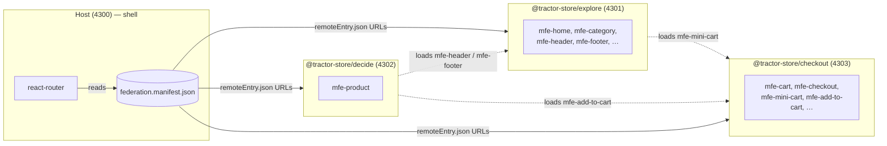

# Tractor Store — Documentation

The Tractor Store is a four-app micro-frontend (MFE) system: a thin
**host** shell plus three independently-deployed **remotes**, each
owned by a separate team. The host owns the URL and the page chrome;
the remotes ship UI as web components and link to each other through
_intent IDs_ instead of hard-coded URLs. All composition happens at
runtime — there is no build-time wiring between apps.

The runtime is [Native Federation][nf]. It is built on ECMAScript
Modules and Import Maps, so what we ship is plain browser-native code
with a small orchestration layer on top.

This React version mirrors the [Angular version](../../../angular/tractor-store/docs/)
file for file; only the framework-specific glue differs.

[nf]: https://native-federation.com/

## New to micro-frontends?

A micro-frontend architecture splits a single web application into
smaller apps that can be built, tested, and deployed independently.
Each team owns its slice end-to-end and the browser composes them at
runtime.

This project follows the [Tractor Store Blueprint][blueprint] — a
reference scenario for comparing MFE techniques across frameworks.
The teams are named for what they do in the customer journey
(**Explore**, **Decide**, **Checkout**), not for technical layers.
That vertical split is the canonical micro-frontends decomposition
described on [micro-frontends.org][mfo].

Three ideas carry the weight in this repo:

1. **Custom elements** (web components). Every UI fragment a remote
   exposes is registered as a `<mfe-*>` HTML tag that renders a React
   root in its shadow DOM. The host (or any other remote) places that
   tag in the DOM and the browser does the rest. The contract is plain
   HTML — no React import crosses team boundaries.
2. **A central event bus** (`window.__NF_REGISTRY__`). Remotes
   publish and subscribe to small, _typed_ events instead of calling
   each other directly. Each event's payload type is listed once in
   the `Events` interface in `libs/contracts/index.ts`; emitter and
   listener then share the same compile-time contract. Navigation and
   store selection ride on this bus.
3. **Intent-based navigation.** A link in the _decide_ micro frontend
   that should open the cart never types `'/checkout/cart'`. It renders
   `<NavLink intent="checkout.cart">`, and the host translates that to
   a URL. A team can rename its routes without touching anyone else's
   code.

Together these three keep the apps decoupled. The apps share no
runtime code at all: each one writes out its own bootstrap, loader
and link component, so its flow can be read in its own folder. The
rest of this doc set explains how each piece is implemented.

[blueprint]: https://github.com/neuland/tractor-store-blueprint
[mfo]: https://micro-frontends.org/

## At a glance

The manifest is the only static "wiring": every app fetches it at
startup and uses it to locate the others. The dotted lines are
_cross-remote fragment loads_ — a remote can mount another remote's
custom element inside its own page without going through the host.

## Read next

- **[Architecture](./architecture.md)** — what the host owns, what
  each remote owns, and the three decoupling mechanisms (custom
  elements, the event bus, intent-based navigation) plus why only
  types are shared.
- **[Navigation](./navigation.md)** — the intent-based navigation
  system and why it is the load-bearing piece of the host/remote
  decoupling.
- **[Features](./features.md)** — what each team ships, the
  fragments they expose, the events they emit, and the cross-remote
  dependencies between them.

## Where does X live?

| Concern                                          | File / module                                                                    |
| ------------------------------------------------ | -------------------------------------------------------------------------------- |
| Bootstrap & federation init (every app)          | `apps/<app>/src/main.tsx`                                                        |
| Host CDN assets, React root                      | `apps/host/src/app/bootstrap.tsx`                                                |
| Loading contributions, routes, resolver, `nav:navigate` | `apps/host/src/app/navigation.tsx` (`createNavigation`)                   |
| Host route → element mount                       | `apps/host/src/app/remote-shell.tsx`                                             |
| Loading a remote's custom element                | `apps/host/src/app/load-remote.ts`, `apps/<remote>/src/shared/remote-element.ts` (`createRemoteLoader`) |
| Embedding a foreign `mfe-*` element              | `apps/<remote>/src/shared/remote-element.ts` (`useRemoteElement`)                |
| Per-remote app, custom-element wrapper, styles, CDN URLs | `apps/<remote>/src/app.tsx` (`getApp`, `createCustomElement`, `useStyles`, `useCdn`) |
| Remote bootstrap (custom element)                | `apps/<remote>/src/features/<feature>/bootstrap.tsx`                             |
| Remote nav contribution                          | `apps/<remote>/src/nav-contribution.ts`                                          |
| Cross-MFE link (`<NavLink>`, `useNavIntent`)     | `apps/<remote>/src/shared/nav-intent.tsx`                                        |
| Shared types: env, contributions, params, `Events`, `mfe-*` JSX tags | `libs/contracts/index.ts`                                    |
| Cart state & cross-tab sync                      | `apps/checkout/src/data/cart-store.ts`                                           |
| Mock backend data                                | `apps/<remote>/src/data/<entity>.data.ts`                                        |
| Federation config (per app)                      | `apps/<app>/federation.config.mjs`                                               |
| Build & dev server (per app)                     | `apps/<app>/build.mjs`                                                           |
| Runtime remote discovery                         | `apps/<app>/public/federation.manifest.json`                                     |
| Per-environment values                           | `apps/<app>/public/env.config.json`                                              |
| Team boundary visualisation overlay              | `public/cdn/js/helper.js`                                                        |
