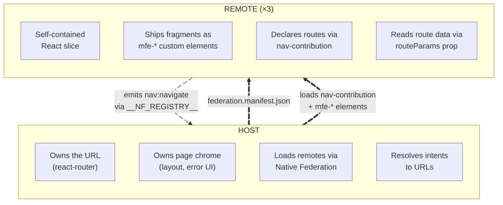
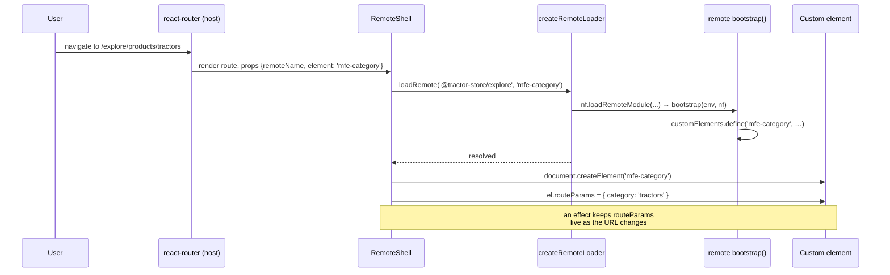
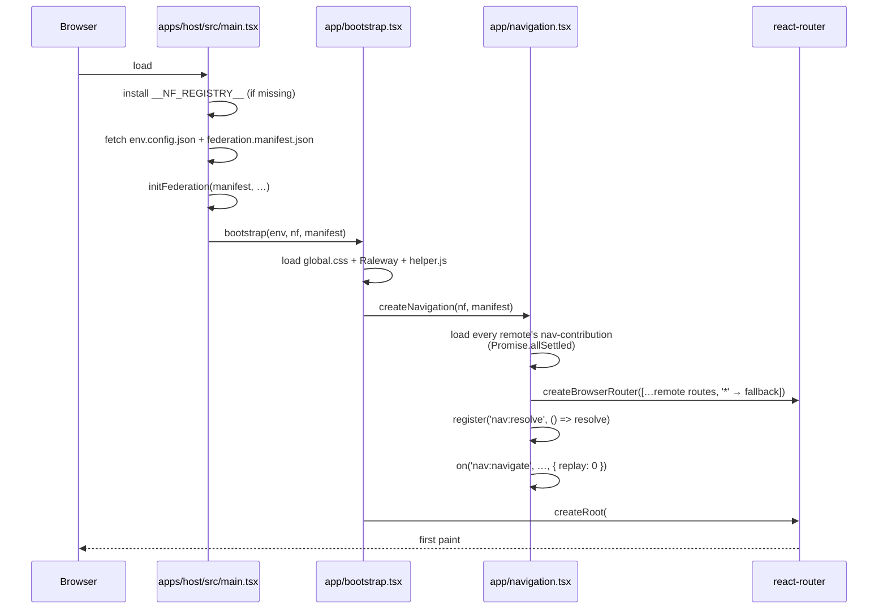

# Architecture

This document explains the contract between the host and the remotes —
what each side owns, where the boundary sits, and how the three
decoupling mechanisms (custom elements, the event bus, intent-based
navigation) make runtime composition possible without coupling the apps
together. A short note on the contracts library closes it out.

## Why decoupling matters

Three teams ship three React applications into one page. The
architecture has one job: keep those teams independent. _Independent_
means a team can rename a route, swap an internal component, or roll a
backend change forward without coordinating with the other teams.

Whenever two MFEs talk to each other directly — by importing
components, sharing a router, or sharing a React context — they pick up
a hidden dependency that turns "deploy whenever you want" into "deploy
whenever the other team is ready". The architecture below avoids that
by inserting an explicit, stable contract at every place where the apps
meet.

> Michael Geers, _micro-frontends.org_: "_Isolate Team Code — Don't
> share a runtime, even if all teams use the same framework. Build
> independent apps that are self-contained._"

## The two-layer model



The contract has exactly four touchpoints:

1. **`federation.manifest.json`** — the host's list of remote names →
   entry URLs, fetched at startup.
2. **`nav-contribution`** — a module each remote _exposes_ that
   declares its base path and the intents (routable destinations) it
   owns.
3. **`mfe-*` custom elements** — the actual UI fragments, also exposed
   via federation. The host instantiates them with
   `document.createElement`.
4. **`routeParams`** — a single property the host writes onto a
   mounted custom element, carrying parsed path and query parameters.

Nothing else is shared at the boundary. There is no `import` from a
remote in host code, no React context crossing the line, no shared
router state.

## The three decoupling mechanisms

### 1. Custom elements as the integration surface

A remote does not ship React components for the host to import. It
ships **custom elements** registered under stable `mfe-*` tags. Each
element owns a shadow root with its own React root inside.

Each remote creates its app in `app.tsx`, and every exposed element has
a `bootstrap.tsx` that defines its tag on top of that app:

```tsx
// apps/explore/src/app.tsx
let app: App | undefined;

export const getApp = (env: EnvironmentConfig, nf: NativeFederationResult): App =>
  (app ??= { env, loadRemote: createRemoteLoader(env, nf) });

// apps/explore/src/features/header/bootstrap.tsx
export const bootstrap = async (env: EnvironmentConfig, nf: NativeFederationResult): Promise<void> => {
  if (customElements.get('mfe-header')) return;
  customElements.define('mfe-header', createCustomElement(Header, getApp(env, nf)));
};
```

`createCustomElement` (also in `app.tsx`) is the React counterpart of
Angular's `createCustomElement` from `@angular/elements`: it returns an
`HTMLElement` subclass that attaches a shadow root on connect, renders
the component into it with `createRoot`, and re-renders when the host
writes `routeParams` or an observed attribute changes. The component
receives those as props; the `App` (env and remote loader) reaches it
through a React context.

This code is deliberately repeated in every remote rather than hidden
behind a shared helper. Open any `bootstrap.tsx` and the whole path from
"the host asked for `mfe-header`" to "the tag is defined" is on screen.

Four consequences worth calling out:

- **Plain HTML is the contract.** A consumer drops `<mfe-cart>` in its
  JSX; nothing else is required. No component, hook or context crosses
  the boundary. The tags other teams may embed, and the attributes they
  read, are declared for JSX in `libs/contracts/index.ts`.
- **One app per remote.** `getApp` creates the remote's `App` on the
  first bootstrap and caches it in a module-level `let`. Every element of
  that remote shares it, and module state too: when explore's header
  shows `<mfe-mini-cart>` and decide's product page shows
  `<mfe-add-to-cart>`, both elements come from checkout's bundle and
  share one cart store.
- **Bootstrap is idempotent.** Each `bootstrap.tsx` checks
  `customElements.get(tag)`, and so does the remote loader. It is safe
  to request the same fragment from many places at once: only the first
  call defines the element.
- **Shadow DOM per element.** Every `mfe-*` element renders in its own
  shadow root. Components add their CSS with `useStyles(css)`, which
  adopts one shared `CSSStyleSheet` per stylesheet into that root.
  Global values such as `--outer-space` and the font come from the
  host's `global.css` and inherit into the shadow roots.

> Cam Jackson, _martinfowler.com_: "_Each micro frontend is to define
> an HTML custom element for the container to instantiate, instead of
> defining a global function for the container to call._"

#### Loading a fragment: `createRemoteLoader`

Every app that embeds another team's element has the same small loader:
`apps/host/src/app/load-remote.ts` in the host, and
`src/shared/remote-element.ts` in each remote.

```ts
export const createRemoteLoader =
  (env: EnvironmentConfig, nf: NativeFederationResult): LoadRemote =>
  async (remoteName, element) => {
    if (customElements.get(element)) return;
    const mod = await nf.loadRemoteModule<RemoteElementModule>(remoteName, element);
    await mod.bootstrap(env, nf);
  };
```

The host provides it through `LoadRemoteContext` in `app/bootstrap.tsx`;
each remote keeps it on its `App`. Components never call it by hand. In
the remotes they call `useRemoteElement` (also in
`shared/remote-element.ts`) with the remote and the tag they render:

```tsx
useRemoteElement('@tractor-store/explore', 'mfe-header');
// …
return <mfe-header></mfe-header>;
```

The loader hands `nf` (the federation runtime) to the remote's
bootstrap, and that remote builds its own loader from it. That is how
cross-remote loads work even when the host is not in the picture:
explore's header calls `useRemoteElement('@tractor-store/checkout',
'mfe-mini-cart')` and it just works.

#### Why a single `routeParams` property and not attributes

`HTMLElement` reserves a long list of property names (`id`, `slot`,
`title`, `hidden`, `style`, …). If the host wrote each route param as
its own attribute or property it would silently collide with
intrinsics. Instead, all params land under one well-known property
(`routeParams`, typed as `RouteParams` in `libs/contracts/index.ts`). A
routed page receives it as a prop,
`function Product({ routeParams = {} }: { routeParams?: RouteParams })`,
and reads the keys it needs. Clean separation, zero collisions.

#### How a route activation lands a custom element on the page



`RemoteShell` (`apps/host/src/app/remote-shell.tsx`) follows exactly
this script. `remoteName` and `element` come from the route that
`navigation.tsx` built. An effect calls the loader and appends the
element; while it is loading the shell shows a spinner, and if the load
fails it shows an error message. `useParams` + `useSearchParams` are
merged into one `routeParams` object, memoised on its JSON so the element
only sees a new object when a value actually changed.

### 2. The event bus (`window.__NF_REGISTRY__`)

Custom elements solve composition: a remote can mount another remote's
UI. But the remotes also need to _talk_ to each other. They do that
through a small, shared event bus that each app's `main.tsx` installs
before React loads.

The bus lives on `window.__NF_REGISTRY__` and is created at the top of
every app's `main.tsx`, so a remote running standalone gets a bus too:

```ts
window.__NF_REGISTRY__ ??= Object.freeze(
  createRegistry({ maxStreams: 20, maxEvents: 1, removePercentage: 0.25 })(),
);
```

It is the [event registry][nf-registry] of the Native Federation
orchestrator: event streams (`emit(name, data)` / `on(name, handler)`)
plus latched resources (`register(name, value)` / `onReady(name,
handler)`). The apps call it directly; there is no wrapper around it.
What the teams agree on is the `Events` interface in
`libs/contracts/index.ts`, which maps every event name to its payload
type:

```ts
// libs/contracts/index.ts
export interface Events {
  'nav:navigate': NavigatePayload;
  'nav:resolve': NavResolver;
  'store:selected': StoreSelectedPayload;
}
```

Emitting and listening look the same in every app:

```tsx
// apps/explore/src/features/store-picker/StorePicker.tsx
window.__NF_REGISTRY__!.emit<Events['store:selected']>('store:selected', { id: store.id });

// apps/checkout/src/features/checkout/Checkout.tsx
useEffect(
  () =>
    window.__NF_REGISTRY__!.on<Events['store:selected']>('store:selected', ({ data }) =>
      setStoreId(data.id),
    ),
  [],
);
```

`on` returns its unsubscribe function, which doubles as the effect's
cleanup. It replays the last event to a new subscriber by default. The
host subscribes to `nav:navigate` with `{ replay: 0 }`, because a
navigation command must never be replayed. `nav:resolve` is a resource,
so a link that renders after the host published it receives it at once.

> **Gotcha:** `register(name, value)` treats a function `value` as a
> provider and stores what it _returns_. The host publishes its resolver
> function as `register('nav:resolve', () => resolve)`.

[nf-registry]: https://native-federation.com/docs/v4/orchestrator/event-registry

The type parameter (`Events['store:selected']`) makes a payload that
doesn't match the contract a compile-time error. The event name itself
is still a string, so keep it next to the type in `Events` and search
for it when you rename it.

#### The channels in use today

| Event            | Direction                 | Purpose                                                                         |
| ---------------- | ------------------------- | ------------------------------------------------------------------------------- |
| `nav:navigate`   | remote → host             | Intent-based navigation requests (from `<NavLink>` or emitted directly)         |
| `nav:resolve`    | host → remotes (resource) | The `NavResolver` (`(id, payload) => url \| null`) so links render real `href`s |
| `store:selected` | explore → checkout        | Notify checkout when the user picks a pickup store                              |

State that stays inside one remote does not need the bus. All of
checkout's elements (`<mfe-cart>`, `<mfe-mini-cart>`,
`<mfe-add-to-cart>`, …) run from the same checkout bundle, so they share
one module-level cart store (`apps/checkout/src/data/cart-store.ts`)
and `useSyncExternalStore` keeps them in step. A second browser tab is
kept in sync by the store listening to the window's `storage` events.

### 3. Intent-based navigation

Each remote declares a `nav-contribution`
(`apps/<remote>/src/nav-contribution.ts`) listing its routable intents:

```ts
// apps/checkout/src/nav-contribution.ts
export const navContribution: NavContribution = {
  basePath: 'checkout',
  intents: [
    { id: 'cart', path: '/cart', element: 'mfe-cart' },
    { id: 'checkout', path: '/checkout', element: 'mfe-checkout' },
    { id: 'thanks', path: '/thanks', element: 'mfe-thanks' },
  ],
};
```

The remote owns relative intent IDs (`cart`, `checkout`, `thanks`).
The host prepends each contribution's `basePath` when it registers
them, producing the public IDs other teams link to (`checkout.cart`,
etc.). Remotes link by intent, never by URL. Full walkthrough in
[navigation.md](./navigation.md).

## The bootstrap chain



Every app's `main.tsx` does the same three steps; only the last line
differs. The host bootstraps its React app, a standalone remote
defines its default page with `bootstrap(env, nf)` (the tag is already
in its `index.html`). `main.tsx` statically imports only the
orchestrator: it runs before the import map exists, so React is only
reached through the dynamically imported bootstrap. That is also why
`build.mjs` bundles `main.tsx` with `splitting: true` and every shared
package external. Two artefacts drive everything, both fetched with
`cache: 'no-cache'`:

- **`env.config.json`** — per-environment values: `cdnUrl` and
  `production` (`EnvironmentConfig` in `libs/contracts/index.ts`).
  Same shape across all four apps.
- **`federation.manifest.json`** — the discovery file:

  ```json
  {
    "@tractor-store/explore": "http://localhost:4301/remoteEntry.json",
    "@tractor-store/decide": "http://localhost:4302/remoteEntry.json",
    "@tractor-store/checkout": "http://localhost:4303/remoteEntry.json"
  }
  ```

  `initFederation` merges every remote's `remoteEntry.json` into the
  page's import map so any subsequent
  `nf.loadRemoteModule(remoteName, exposedModule)` resolves to the
  right bundle.

`__NF_REGISTRY__` is installed _before_ federation init, so remotes
that touch the bus during their own bootstrap always find it there.

## Contracts, not a shared library

The apps share **no runtime code**. Every piece of wiring (the
bootstrap, the custom-element wrapper, the remote loader, the link
component, the button) lives in the app that uses it, even when that
means three copies. That keeps each app readable on its own and lets
each team change its copy without coordinating a release with the
others.

What the teams _do_ agree on lives in one types-only file,
`libs/contracts/index.ts`, imported as `@tractor-store/contracts`
(a path alias in `tsconfig.base.json`):

| Type                                                 | Agreed between                                     |
| ---------------------------------------------------- | -------------------------------------------------- |
| `EnvironmentConfig`                                  | every app's `env.config.json`                      |
| `RemoteElementModule`                                | the loaders and every exposed `bootstrap.tsx`      |
| `NavContribution`, `NavIntent`                       | each remote's `nav-contribution.ts` and the host   |
| `NavPayload`, `NavResolver`, `RouteParams`           | the host's navigation and the remotes' pages/links |
| `Events` (+ payload types), `window.__NF_REGISTRY__` | everyone on the event bus                          |
| `JSX.IntrinsicElements` for embeddable `mfe-*` tags  | the owning team and every team embedding the tag   |

Because it is imported with `import type` only, it compiles away:
nothing from it exists at runtime and nothing needs to be shared
through federation. Each app's `federation.config.mjs` therefore has an
empty `sharedMappings` (`apps/host/federation.config.mjs`):

```js
shared: fromPackageJson({ singleton: true, strictVersion: true, requiredVersion: 'auto', build: 'package' })
  .patch(['react', 'react-dom'], { includeSecondaries: { keepAll: true } })
  .get(),
sharedMappings: [],
skip: ['react-dom/server', 'react-dom/server.node', 'react-dom/server.browser', 'react-dom/test-utils'],
```

What the flags mean:

- **`singleton: true` on every package dependency, React included.**
  Exactly one React on the page. Two copies would each have their own
  hooks dispatcher, and a component rendered by the wrong one throws
  "Invalid hook call". `strictVersion: true` makes a version mismatch
  fail loudly at load time.
- **`includeSecondaries: { keepAll: true }` on `react` and
  `react-dom`.** Publishes `react/jsx-runtime`, `react-dom/client`, … as
  shared too, so every remote gets the shared copy.
- **`sharedMappings: []`.** Left out, Native Federation would share
  every TypeScript path alias. There is nothing to share, so it is
  turned off explicitly.
- **`skip`** drops the server-only `react-dom` entry points.

> Cam Jackson, _martinfowler.com_: "_Be careful to ensure that your
> shared components contain only UI logic, and no business or domain
> logic._"

This demo goes one step further and doesn't even share the dumb
primitives: explore and checkout each have their own button. For a
demo, seeing every app's flow in one place is worth more than the saved
lines. A real product with a design system would publish it as a
versioned npm package and share it through `shared`, not through a path
alias.

## Team boundary visualisation

Each team has a colour:

| Team     | Hex       | Owns                      |
| -------- | --------- | ------------------------- |
| Explore  | `#FF5A54` | Catalog, header, footer   |
| Decide   | `#53FF90` | Product detail            |
| Checkout | `#FFDE54` | Cart, checkout, mini-cart |

The CDN ships a small overlay script (`public/cdn/js/helper.js`,
loaded by the host at bootstrap). It looks for `data-boundary` and
`data-boundary-page` attributes on rendered DOM and, when
`html.showBoundaries` is set, draws coloured boxes around each team's
contribution. The only _enforcement_ of team boundaries is the build:
each app compiles on its own, so a remote cannot import code from
another remote, only the types in `@tractor-store/contracts`.

## See also

- [Navigation](./navigation.md) — how the intent system makes the
  boundary navigable without coupling.
- [Features](./features.md) — concrete catalogue of what each remote
  ships and which events it speaks.
