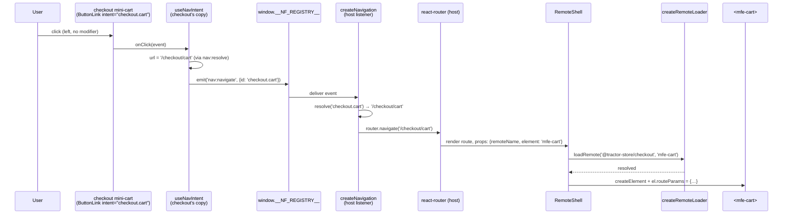

# Navigation

The Tractor Store has *one* router (in the host) and *zero* hard-coded
cross-team URLs in the remotes. A click in `decide` that should land
on the cart never mentions `/checkout/cart` — it emits the **intent**
`checkout.cart` and lets the host figure out the URL.

## The problem with the obvious solutions

In a naïve micro-frontend setup, remote A linking to remote B picks
one of two bad options:

- **Hard-code the URL.** Now A breaks every time B reorganises its
  routes, and renaming `/checkout` becomes a coordinated multi-team
  migration.
- **Import B's routes.** Now A and B are build-time coupled, share a
  router instance, and can't deploy independently.

Both options leak B's URL scheme into A. The intent system removes
the leak by letting each remote keep ownership of its URLs while
exposing a stable, public name (the intent) to the rest of the world.

## The contract: `nav-contribution`

Each remote *exposes* (via `federation.config.mjs`) a
`nav-contribution` module (`apps/explore/src/nav-contribution.ts`):

```ts
export const navContribution: NavContribution = {
  basePath: 'explore',
  intents: [
    { id: 'home',              path: '/',                    element: 'mfe-home' },
    { id: 'products',          path: '/products',            element: 'mfe-category' },
    { id: 'products.category', path: '/products/{category}', element: 'mfe-category' },
    { id: 'stores',            path: '/stores',              element: 'mfe-stores' },
  ],
};
```

The shape (`NavContribution` in `libs/contracts/index.ts`) carries no
remote name; the host already knows it from the manifest key:

- `basePath` — the URL prefix the host mounts the remote under.
- `intents[]` — every destination the remote owns:
  - `id` — the public name *relative to the remote*. The host prepends
    `basePath`, so `explore`'s `{ id: 'home' }` becomes `explore.home`.
  - `path` — the path *inside* `basePath`, with optional `{param}`
    segments. The host turns these into react-router's `:param` form,
    so the contribution stays framework-neutral (the Angular remotes
    use the exact same shape).
  - `element` — the `mfe-*` custom element to render at that path.
    Intents without one are link-only.

Each remote has a test (`src/nav-contribution.test.ts`) that checks
every `element` is listed in its `exposes`, because the host loads it
with `loadRemoteModule(remoteName, element)`.

## Boot-time wiring

When the host starts, it loads every remote's `nav-contribution` in
parallel and uses them to build its routes and a _resolver_: a
function that turns an intent ID plus payload into a URL. All of it
lives in `apps/host/src/app/navigation.tsx`:

```tsx
export const createNavigation = async (nf: NativeFederationResult, manifest: FederationManifest) => {
  const registry = window.__NF_REGISTRY__!;
  const contributions = await loadContributions(nf, manifest);

  const routes = toRoutes(contributions);
  // Unknown URLs go to the store's home, or to any page that still loaded when explore is down.
  const fallback =
    routes.find((route) => route.path === '/explore') ??
    routes.find((route) => !route.path?.includes(':'));
  const router = createBrowserRouter(
    fallback ? [...routes, { path: '*', loader: () => redirect(fallback.path!) }] : routes,
  );

  const resolve = createResolver(contributions);
  // see Events['nav:resolve']
  await registry.register<Events['nav:resolve']>('nav:resolve', () => resolve);

  registry.on<Events['nav:navigate']>(
    'nav:navigate',
    ({ data: { id, payload } }) => {
      const url = resolve(id, payload);
      if (url === null) console.error(`[nav] cannot navigate to "${id}"`);
      else void router.navigate(url);
    },
    { replay: 0 },
  );

  return router;
};
```

It does four things:

1. **Loads contributions.** `loadContributions` uses
   `Promise.allSettled`, so a broken remote is skipped with a console
   warning instead of breaking the whole shell.
2. **Creates the router** with one route per intent that has an
   `element`. Every route renders the same `RemoteShell`; only its
   props differ:

   ```tsx
   {
     path: '/explore/products/:category',
     element: <RemoteShell remoteName="@tractor-store/explore" element="mfe-category" />,
   }
   ```

3. **Publishes the resolver as `nav:resolve`.** It is a registry
   _resource_, so a link that renders later still receives it at once.
   The remotes use it to render real `href` attributes (so
   middle-click, "copy link", and screen-reader URL announcements
   work). `register()` would call a function argument as a provider,
   hence `() => resolve`.
4. **Handles `nav:navigate`.** Every `<NavLink>` click and every
   programmatic navigation in any remote lands here, is resolved, and
   hits the router. It subscribes with `replay: 0`, so an old command is
   never replayed.

`bootstrap.tsx` awaits `createNavigation` before rendering, so by the
first frame the resolver is published and routing is wired.

## Linking from a remote: `<NavLink>`

Remotes never type a URL and never import a router. Each remote that
renders links has its own `src/shared/nav-intent.tsx` (the copies in
explore, decide and checkout are identical):

```tsx
<NavLink intent="checkout.cart">Cart</NavLink>

<NavLink intent="decide.product" payload={{ id: product.id }}>
  See details
</NavLink>
```

The hook behind it:

```tsx
export const useNavIntent = (intent: string, payload: NavPayload = {}) => {
  const [resolve, setResolve] = useState<NavResolver>();
  useEffect(
    () =>
      window.__NF_REGISTRY__!.onReady<Events['nav:resolve']>('nav:resolve', (resolver) =>
        setResolve(() => resolver),
      ),
    [],
  );
  const url = resolve?.(intent, payload) ?? null;

  const onClick = (event: MouseEvent<HTMLElement>): void => {
    // Leave new-tab and new-window clicks on real links to the browser.
    if (event.currentTarget.tagName === 'A' && isModifiedClick(event)) return;
    if (url === null) return;
    event.preventDefault();
    window.__NF_REGISTRY__!.emit<Events['nav:navigate']>('nav:navigate', { id: intent, payload });
  };

  return { url, onClick, 'aria-disabled': url === null ? true : undefined };
};
```

A plain left-click is intercepted and converted into a `nav:navigate`
event (no full reload). A middle-click, `Ctrl+click`, or "Copy link
address" is *not* intercepted: the real `href` is on the anchor, so the
browser does the right thing. Checkout's `ButtonLink` is a `NavLink`
with button styling.

When the resolver returns `null` (an unknown intent, or a missing path
param), the link emits nothing and gets `aria-disabled="true"`. If an
unknown intent still reaches the host (from a programmatic emit), the
host logs `[nav] cannot navigate to "…"`.

## Reading params on the receiving end

Once the host's route renders, `RemoteShell` mounts the right custom
element and writes a `routeParams` object onto it. The remote component
receives it as a prop:

```tsx
// apps/decide/src/features/product/Product.tsx
const param = (params: RouteParams, key: string) =>
  typeof params[key] === 'string' ? params[key] : undefined;

export function Product({ routeParams = {} }: { routeParams?: RouteParams }) {
  const id = param(routeParams, 'id');
  const sku = param(routeParams, 'sku');
  // …
}
```

Repeated query params arrive as arrays (`RouteParams` is
`Record<string, string | readonly string[]>`); `param` only accepts a
single value.

## End-to-end: a click in `checkout` becomes a URL change



The mini-cart sits inside explore's header, but the link and the page
it opens both belong to checkout. No import between remotes, no shared
router, no string `'/checkout/cart'` typed anywhere in a remote.

## Programmatic navigation: emit directly

`<NavLink>` is for JSX. From an event handler, a remote emits the same
event:

```tsx
// apps/checkout/src/features/checkout/Checkout.tsx
cart.clear();
window.__NF_REGISTRY__!.emit<Events['nav:navigate']>('nav:navigate', {
  id: 'checkout.thanks',
});
```

## Resolving params and query strings

- **Path params** — placeholders in the intent's `path`, e.g.
  `/product/{id}`, filled in from the payload and URL-encoded.
- **Query params** — anything in the payload that wasn't consumed by a
  placeholder is appended as a query string.

So `{ id: 'decide.product', payload: { id: 'CL-01', sku: 'CL-01-GR' } }`
resolves to `/decide/product/CL-01?sku=CL-01-GR`. The split happens in
`createResolver` in `apps/host/src/app/navigation.tsx` (covered by
`navigation.test.tsx`). Because the remotes ask the host's resolver for
their `href`s instead of filling templates themselves, an anchor's
`href` and the URL the host navigates to can never disagree.

## What this design buys you

- **Independent deploys.** A team can rename `/checkout/cart` to
  `/cart` by editing one path in their own `nav-contribution.ts`.
- **No router in remotes.** Only the host depends on `react-router-dom`.
- **The host owns zero remote-specific knowledge.** It builds routes
  generically from the contributions it loaded.
- **Testable in isolation.** Each remote runs standalone on its own
  port with the same `federation.manifest.json`. When `decide` boots on
  `:4302` it loads `mfe-header` from `:4301` and `mfe-add-to-cart` from
  `:4303` just like the host would. (Without a host there is no
  resolver, so links render without an `href`.)

## See also

- [Architecture](./architecture.md) — the runtime and custom-element
  bridge that the navigation layer rides on top of.
- [Features](./features.md) — the full list of intents per team.
