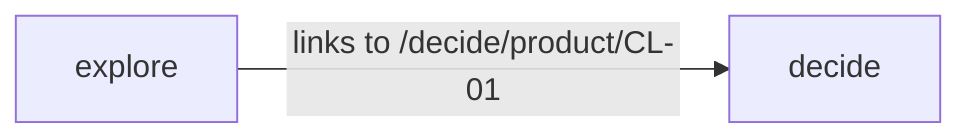
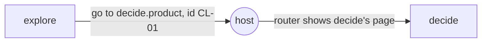
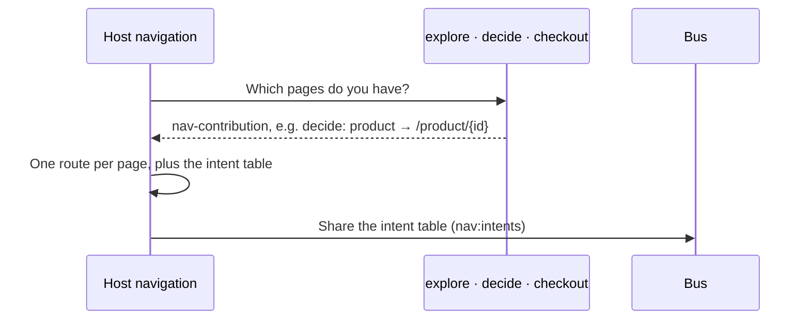
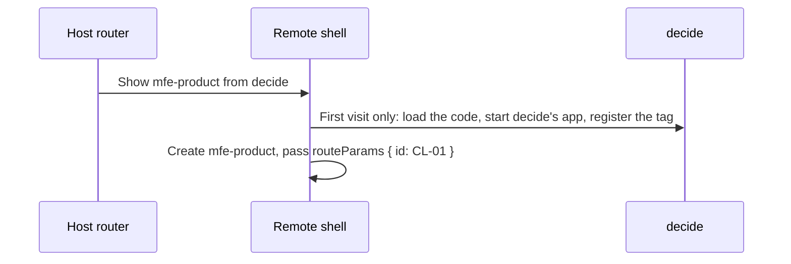

# Navigation

The Tractor Store has *one* router (in the host) and *zero* hard-coded
cross-team URLs in the remotes. A click in `decide` that should land
on the cart never types `/checkout/cart` — it names the **intent**
`checkout.cart`, and the URL is filled in from the intent table that
the host collects from the remotes.

This document walks through how that works, why the intent system is
the load-bearing piece of the host/remote decoupling, and how a click
in one remote becomes a route activation in another.

## The problem with the obvious solutions

In a naïve micro-frontend setup, remote A linking to remote B picks
one of two bad options:

- **Hard-code the URL.** Now A breaks every time B reorganises its
  routes, and renaming `/checkout` becomes a coordinated multi-team
  migration.
- **Import B's routes.** Now A and B are build-time coupled, share a
  router instance, and can't deploy independently.

With a hard-coded URL, explore knows where decide keeps its pages:



Both options leak B's URL scheme into A. The intent system removes
the leak entirely by letting each remote keep ownership of its URLs
while exposing a stable, public name (the intent) to the rest of the
world:



Explore names *what* it wants. Decide declares *where* that is, the
host collects every remote's declarations and publishes them, and
every app reads them. What explore never contains is a typed URL.

If you're familiar with Android's deep-link Intents, the model is the
same: the caller names *what* it wants to reach, the platform decides
*where* that lives.

## The contract: `nav-contribution`

Each remote *exposes* (via `federation.config.mjs`) a
`nav-contribution` module. It is a single object describing what the
remote routes (`apps/explore/src/nav-contribution.ts`):

```ts
export const navContribution: NavContribution = {
  basePath: 'explore',
  intents: [
    { id: 'home',              path: '/',                    element: 'mfe-home' },
    { id: 'products',          path: '/products',            element: 'mfe-category' },
    { id: 'products.category', path: '/products/{category}', element: 'mfe-category' },
    { id: 'stores',            path: '/stores',              element: 'mfe-stores' },
  ],
};
```

The shape (`NavContribution` in `libs/contracts/index.ts`) carries no
remote name; the host already knows it from the manifest key:

- `basePath` — the URL prefix the host will mount the remote under
  (`/explore`, `/decide`, `/checkout`).
- `intents[]` — every destination the remote owns:
  - `id` — the public name *relative to the remote*. The host prepends
    `basePath`, so `explore`'s `{ id: 'home' }` becomes the public
    `explore.home`. Other remotes link to the full ID, never to a URL.
  - `path` — the path *inside* `basePath`, with optional `{param}`
    segments. The host turns these into react-router's `:param` form
    when it registers routes, so the contribution stays
    framework-neutral.
  - `element` — the `mfe-*` custom element to render at that path.
    Intents without one are link-only.

The full intent ID is the only thing that crosses team boundaries.
URLs and element tags are an implementation detail of the owning
team. Each remote has a test (`src/nav-contribution.test.ts`) that
checks every `element` is actually listed in its `exposes`, because
the host loads it with `loadRemoteModule(remoteName, element)`.

## At startup, each team declares its pages

The _intent table_ maps every full intent id to its path, e.g.
`decide.product` → `/decide/product/{id}`; the host builds it from the
remotes' contributions and shares it on the bus as `nav:intents`.



This happens once, before the first page renders. A remote that is
down is skipped, and the rest of the store works without it. After
this step the host never asks a remote where its pages live again.

In code, "Host navigation" is `apps/host/src/app/navigation.tsx`
(here `createNavigation`), and the intent table is the `NavIntents`
object from `toIntents`.

## Startup, in code

When the host starts, it loads every remote's `nav-contribution` in
parallel and uses them to build its routes and the _intent table_
(`NavIntents`). Every app fills in the `{params}` with `urlFor`
(see [Filling in params and query strings](#filling-in-params-and-query-strings)).

All of it lives in one file,
`apps/host/src/app/navigation.tsx`, which reads top to bottom:

```tsx
export const createNavigation = async (
  nf: NativeFederationResult,
  manifest: FederationManifest,
): Promise<Navigation> => {
  const contributions = await loadContributions(nf, manifest);

  const routes = toRoutes(contributions);
  // Unknown URLs go to the store's home, or to any page that still loaded when explore is down.
  const fallback =
    routes.find((route) => route.path === '/explore') ??
    routes.find((route) => !route.path?.includes(':'));
  const router = createBrowserRouter(
    fallback ? [...routes, { path: '*', loader: () => redirect(fallback.path!) }] : routes,
  );

  const intents = toIntents(contributions);
  bus.emit('nav:intents', intents);

  return { router, intents };
};

export const handleNavigateCommands = (
  router: Pick<AppRouter, 'navigate'>,
  intents: NavIntents,
): (() => void) =>
  // replay: false ignores a stale command if a remote emitted it without retain: false.
  bus.on(
    'nav:navigate',
    ({ id, payload }) => {
      const url = urlFor(intents, id, payload);
      if (url === null) console.error(`[nav] cannot navigate to "${id}"`);
      else void router.navigate(url);
    },
    { replay: false },
  );
```

It does four things:

1. **Loads contributions.** `loadContributions` uses
   `Promise.allSettled`, so a broken remote does not break the whole
   store. It is skipped with a console warning.
2. **Creates the router** with one route per intent that has an
   `element`. Every route renders the same `RemoteShell`; only its
   props differ. Unknown URLs redirect to explore's home, or to the
   first page without params if explore failed to load:

   ```tsx
   {
     path: '/explore/products/:category',
     element: <RemoteShell remoteName="@tractor-store/explore" element="mfe-category" />,
   }
   ```

3. **Publishes the intent table as `nav:intents`.** It is retained
   _state_ on the bus, so a link that renders later still receives it
   the moment it subscribes. The remotes use it to render real `href`
   attributes on anchors (so middle-click, "copy link", and
   screen-reader URL announcements work).
4. **Handles `nav:navigate`.** Every `<NavLink>` click and every
   programmatic navigation in any remote lands in
   `handleNavigateCommands`, which fills in the URL with `urlFor` and
   hands it to the router.
   `nav:navigate` is a _command_: the remotes emit it with
   `{ retain: false }`, and `handleNavigateCommands` also subscribes
   with `{ replay: false }`, so an old command is never replayed. It
   returns the unsubscribe function, which `NavigationRoot`'s effect
   runs as its cleanup.

`bootstrap.tsx` awaits `createNavigation` before rendering, so by the
first frame the intent table is published. The `nav:navigate` listener is
the cleanup-returning effect of the root `NavigationRoot` component
(`apps/host/src/app/navigation-root.tsx`):

```tsx
export function NavigationRoot({ router, intents }: Navigation) {
  useEffect(() => handleNavigateCommands(router, intents), [router, intents]);
  return <RouterProvider router={router} />;
}
```

So the host only subscribes in an effect after the first render. That
is fine, because commands are click-driven: no remote can send one
before the page it is on has rendered.

## Linking from a remote: `<NavLink>`

Remotes never type a URL and never import a router. Each remote that
renders links has its own `src/shared/nav-intent.tsx` (the copies in
explore, decide and checkout are identical):

```tsx
<NavLink intent="checkout.cart">Cart</NavLink>

<NavLink intent="decide.product" payload={{ id: product.id }}>
  See details
</NavLink>
```

The hook behind it:

```tsx
export const useNavIntent = (intent: string, payload: NavPayload = {}) => {
  const [intents, setIntents] = useState<NavIntents>({});
  useEffect(() => bus.on('nav:intents', setIntents), []);
  const url = urlFor(intents, intent, payload);

  const onClick = (event: MouseEvent<HTMLElement>): void => {
    // Leave new-tab and new-window clicks on real links to the browser.
    if (event.currentTarget.tagName === 'A' && isModifiedClick(event)) return;
    if (url === null) return;
    event.preventDefault();
    navigateTo({ id: intent, payload });
  };

  return { url, onClick, 'aria-disabled': url === null ? true : undefined };
};
```

If the host has already published the intent table, `bus.on`
delivers it as soon as the effect subscribes. A table that arrives
later updates the state, and the `href` follows. `navigateTo` is the
remote's one way to emit `nav:navigate`, and `urlFor` fills in an
intent's path. Both live in `src/shared/navigate.ts`:

```ts
// The only place that emits nav:navigate: a command, so a listener that subscribes later never gets it.
export const navigateTo = (target: NavigatePayload): void =>
  bus.emit('nav:navigate', target, { retain: false });

// Payload keys fill the path's `{param}` segments; the rest become the query string.
export const urlFor = (
  intents: NavIntents,
  id: string,
  payload: NavPayload = {},
): string | null => {
  // hasOwn, so an id like 'constructor' doesn't hit Object.prototype.
  const path = Object.hasOwn(intents, id) ? intents[id] : undefined;
  if (path === undefined) return null;
  const params = [...path.matchAll(PARAM)].map(([, name]) => name);
  if (params.some((name) => payload[name] === undefined)) return null;

  const url = path.replace(PARAM, (_, name: string) =>
    encodeURIComponent(payload[name]),
  );
  const query = Object.entries(payload)
    .filter(([key]) => !params.includes(key))
    .map(([key, value]) => `${encodeURIComponent(key)}=${encodeURIComponent(value)}`)
    .join('&');
  return query ? `${url}?${query}` : url;
};
```

That is what makes anchors behave naturally. A plain left-click is
intercepted and converted into a `nav:navigate` command (no full
reload). A middle-click, `Ctrl+click`, or "Copy link address" is *not*
intercepted: the real `href` is on the element, so the browser does
the right thing. Checkout's `ButtonLink` is a `NavLink`
with button styling.

When `urlFor` returns `null` (an unknown intent, or a missing path
param), the link emits nothing and gets `aria-disabled="true"`, so it
is announced as unavailable while staying visible. If an unknown
intent still reaches the host (from a programmatic `navigateTo`), the host
logs `[nav] cannot navigate to "…"`. A half-deployed system fails
*visibly in the console* rather than silently in the URL bar.

## Reading params on the receiving end

Once the host's route renders, `RemoteShell` mounts the right custom
element and writes a `routeParams` object onto it. The remote component
receives it as a prop:

```tsx
// apps/decide/src/features/product/Product.tsx
const param = (params: RouteParams, key: string) =>
  typeof params[key] === 'string' ? params[key] : undefined;

export function Product({ routeParams = {} }: { routeParams?: RouteParams }) {
  const id = param(routeParams, 'id');
  const sku = param(routeParams, 'sku');
  // …
}
```

Repeated query params arrive as arrays (`RouteParams` is
`Record<string, string | readonly string[]>`); `param` only accepts a
single value.

## End to end: a product card in explore opens decide's page

The example is a product card on explore's products page
(`/explore/products`) that links to `decide.product` with
`{ id: 'CL-01' }`.

### A click names an intent, not a URL

```mermaid
sequenceDiagram
    participant Link as Product card (explore)
    participant Bus
    participant Host as Host navigation
    Link->>Bus: On click: go to decide.product, id CL-01
    Bus->>Host: Navigate command (nav:navigate)
    Host->>Host: Fill in the URL from the intent table, router goes to /decide/product/CL-01
```

Explore never declared `decide.product`: decide did, in its
`nav-contribution`, and the host put it in the intent table at
startup. A click sends only the intent and its payload, and Host
navigation fills in the URL from the intent table. Nowhere in explore
is the string `/decide/product` typed.

For the browser's own link features (middle-click, "Copy link
address", screen readers), the link also fills in a real `href` from
the intent table (see
[Filling in params and query strings](#filling-in-params-and-query-strings)).

In code, the link is `<NavLink>` (its `useNavIntent` hook), the
command is sent by `navigateTo`, and Host navigation receives it in
`handleNavigateCommands`, which `NavigationRoot` subscribes in an
effect.

### The page loads when it is needed



Decide's `nav-contribution` was already loaded at startup. What loads
now is the `mfe-product` module, and with it decide's own React app.
A second visit finds the tag already defined and skips the load.

In code, the remote shell is `RemoteShell` and the load goes through
`createRemoteLoader` (`load-remote.ts`).

### When something is missing

| Situation | What the user sees | Logged |
|---|---|---|
| A remote is down at startup | Its pages don't exist. Links to them are visible but disabled (`aria-disabled`, no `href`). A deep link redirects to explore's home. | `Could not fetch remote '<name>'. skipping init.` from the orchestrator, then `[nav] skipping a remote:` (both warnings) |
| A link names an unknown intent or misses a path param | The link is disabled and a click does nothing. | nothing |
| Code calls `navigateTo` with an unknown intent | Nothing happens. | `[nav] cannot navigate to "…"` |
| A remote goes down after startup, then its page is opened for the first time | "Failed to load @tractor-store/decide. Please refresh." in the page area. | `[host] failed to load <mfe-product> from "@tractor-store/decide"` |

## Programmatic navigation: `navigateTo`

`<NavLink>` is for JSX. From an event handler, a remote sends the same
command through its `navigateTo` helper:

```tsx
// apps/checkout/src/features/checkout/Checkout.tsx
cart.clear();
navigateTo({ id: 'checkout.thanks' });
```

Both end up in the same Host navigation listener.

## Filling in params and query strings

Two kinds of parameters can travel with an intent:

- **Path params** — placeholders in the intent's `path`, e.g.
  `/product/{id}`. They are filled in from the `payload` and
  URL-encoded.
- **Query params** — anything in the `payload` that wasn't consumed by
  a placeholder is appended as a query string.

So a call like

```ts
navigateTo({
  id: 'decide.product',
  payload: { id: 'CL-01', sku: 'CL-01-GR' },
});
```

with the contribution `{ id: 'product', path: '/product/{id}', element: 'mfe-product' }`
becomes `/decide/product/CL-01?sku=CL-01-GR`. The remote then reads
`id` and `sku` off `routeParams` on its custom element.

The split happens in `urlFor`. The host publishes only the paths, in
the intent table; every app fills them in with its own copy of the same
`urlFor` (`shared/navigate.ts` in each remote, `navigation.tsx` in the
host, covered by each copy's tests). So an anchor's `href` and the URL
the host navigates to come from identical code.

## What this design buys you

- **Independent deploys.** A team can rename `/checkout/cart` to
  `/cart` by editing one path in their own `nav-contribution.ts`. No
  other remote needs to know: `checkout.cart` still works, it just
  points to a different URL.
- **No router in remotes.** Remotes don't depend on `react-router-dom`
  for navigation. The link hook is ~40 lines in each remote; the router
  lives only in the host.
- **The host owns zero remote-specific knowledge.** It iterates over
  the contributions it loaded and builds routes generically. There is
  no `if (remoteName === 'checkout')` anywhere in the host code.
- **Testable in isolation.** Each remote runs standalone on its own
  port with the same `federation.manifest.json`. When `decide` boots on
  `:4302` it loads `mfe-header` from `:4301` (explore) and
  `mfe-add-to-cart` from `:4303` (checkout) just like the host would.
  (Without a host there is no intent table, so links render without an
  `href`.)
- **Standards-friendly.** All cross-app messaging goes through one
  small bus ([`@softarc/native-federation-communication`][nf-comm]) on
  one global (`globalThis.__NF_BUS__`), typed by one interface
  (`Channels`, augmented in `libs/contracts`).

[nf-comm]: https://github.com/native-federation/communication

The intent system is what turns "three React apps loaded into one
page" into "three independently-evolving products that happen to
share a shell".

## Demoing it

The diagrams in this document are in story order:

1. **The problem:** a hard-coded URL couples explore to decide.
2. **The idea:** explore names an intent, and the host's router shows
   decide's page.
3. **Startup:** each team declares its pages. Show decide's
   `nav-contribution.ts` next to the diagram; it declares one intent.
4. **A click:** explore sends only the intent, and Host navigation
   fills in the URL from the intent table.
5. **The page loads when it is needed.**

Then show it live with `pnpm start:all`. Try each scenario once
before presenting:

- **Rename a URL.** Change decide's `path` from `/product/{id}` to
  `/p/{id}`; only decide's dev server rebuilds (each app's
  `build.mjs --dev` watches only its own sources). Reload the host:
  explore's product links point to `/decide/p/…` and still work,
  although explore was not rebuilt.
- **Turn decide off before loading the store.** The store still
  works, product links show but are disabled, and a deep link to a
  product redirects to explore's home.
- **Stop decide after the store has loaded.** Opening a product shows
  the "Failed to load" message. A product you already opened before
  stopping it still opens, because its code is already loaded.

## See also

- [Architecture](./architecture.md) — the runtime and custom-element
  bridge that the navigation layer rides on top of.
- [Features](./features.md) — the full list of intents per team.
